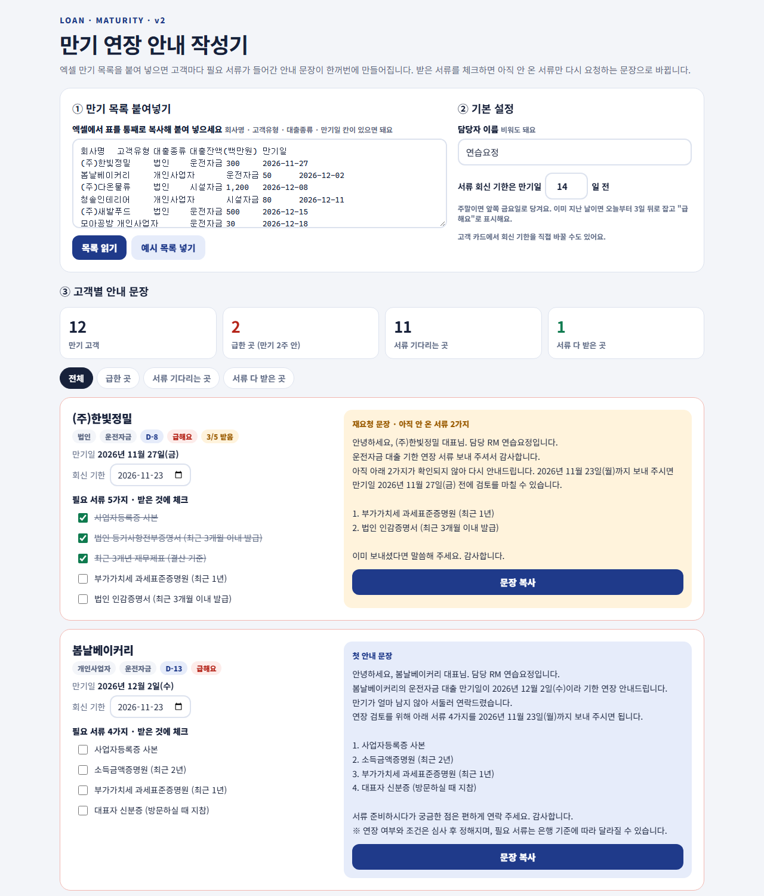

# 만기 연장 안내 작성기 v2

## 한 줄 소개

엑셀 만기 목록을 붙여 넣으면 고객마다 필요 서류가 들어간 연장 안내 문장이 한꺼번에 나오고, 받은 서류를 체크하면 아직 안 온 서류만 다시 요청하는 문장으로 바뀌는 작성기

## 어떤 불편을 줄이나요

v1은 고객 한 명씩 입력해야 했어요. 목록이 15줄이면 15번 다시 입력하고, 서류가 일부만 오면 뭐가 빠졌는지 맞춰 보고 재요청 문장을 새로 써야 했어요. v2는 목록을 한 번 붙여 넣으면 끝이고, 체크만 하면 문장이 알아서 바뀌어요.

## 꼭 필요한 기능

- 만기 목록 붙여넣기 → 고객별 안내 문장 한꺼번에
- 받은 서류 체크 → 재요청 문장 · 접수 완료 문장으로 자동 전환
- 고객별 문장 복사 버튼

## 아낄 수 있는 시간

(예시 가정) 매주 1시간 이상. 안내 문장 쓰기에 재요청 문장까지 줄어요. 실제로 얼마나 아끼는지는 일주일 써 보고 적어요.

## 써 보는 법

- `index.html`을 더블클릭해서 열어요 (예시 목록 12곳이 이미 들어 있어요)
- `만기도래_고객목록_2026-11.xlsx`를 열어 표를 통째로 복사 → 붙여넣기 칸에 붙여 넣고 「목록 읽기」
- (주)한빛정밀 카드에서 서류 3개 체크 → 재요청 문장으로 바뀌는지 보기
- 「급한 곳」 버튼으로 만기 2주 안 고객만 보기
- `test.md`로 검수해 보기

## v1에서 v2로 (Codex에 이렇게 시켰어요)

> v1 PRD의 "있으면 좋은 기능" 중에 ① 엑셀 목록 붙여 넣으면 여러 고객 문장 한꺼번에 ② 받은 서류 체크하면 아직 안 온 서류만 담은 재요청 문장, 이 두 개를 붙여 줘. 잘못된 줄은 건너뛰고 몇 번째 줄인지 알려 주고, 만기 2주 안 고객은 "급해요"로 표시해 줘. 연습용 만기 목록 엑셀도 12줄 만들어 줘.

## 배포 주소

## 화면

## 다음에 붙이고 싶은 기능

- 이번 고객에게 필요 없는 서류 빼기 · 직접 더하기
- 말투 고르기 (정중하게 / 짧게)
