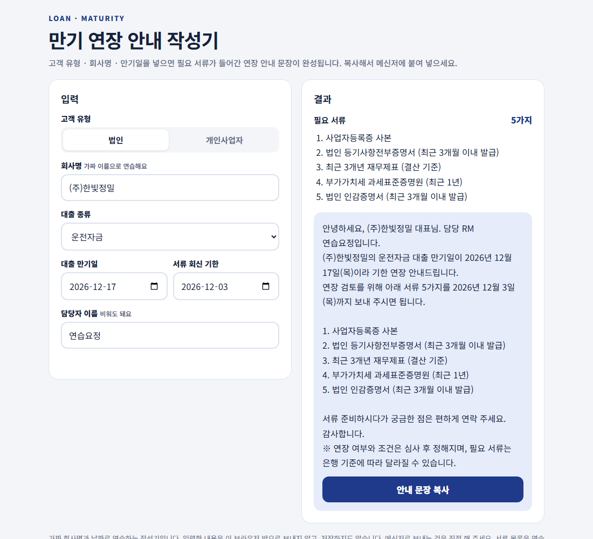

# 만기 연장 안내 작성기

## 한 줄 소개

고객 유형 · 회사명 · 대출 종류 · 만기일을 넣으면 필요 서류 목록이 들어간 만기 연장 안내 문장을 만들어 주는 작성기

## 어떤 불편을 줄이나요

매주 월요일 만기가 다가오는 기업 고객에게 거의 같은 연장 안내를 고객마다 다시 썼어요 (주 15건쯤, 건당 5분). 필요 서류를 빠뜨려서 다시 연락하는 일도 있었어요.

## 꼭 필요한 기능

- 고객 유형 · 회사명 · 대출 종류 · 만기일 · 회신 기한 입력칸
- 고객 유형 · 대출 종류에 맞는 필요 서류 목록이 문장에 자동으로
- 안내 문장 복사 버튼

## 아낄 수 있는 시간

매주 1시간

## 써 보는 법

- `index.html`을 더블클릭해서 열어요 (예시 값이 이미 들어 있어요)
- 법인 → 개인사업자로 바꿔서 서류 목록이 5가지 → 4가지로 바뀌는지 보기
- 대출 종류를 시설자금으로 바꿔서 담보 서류가 하나 더 붙는지 보기
- 회사명에 `010-1234-5678`처럼 번호를 넣으면 경고가 나오는지 보기
- 안내 문장 복사 → 메모장에 붙여 넣기
- `test.md`로 검수해 보기

## 배포 주소

## 화면

## 다음에 붙이고 싶은 기능

- 엑셀에서 만기 고객 목록을 붙여 넣으면 여러 고객 문장을 한꺼번에
- 받은 서류를 체크하면 "아직 안 온 서류"만 담은 재요청 문장
