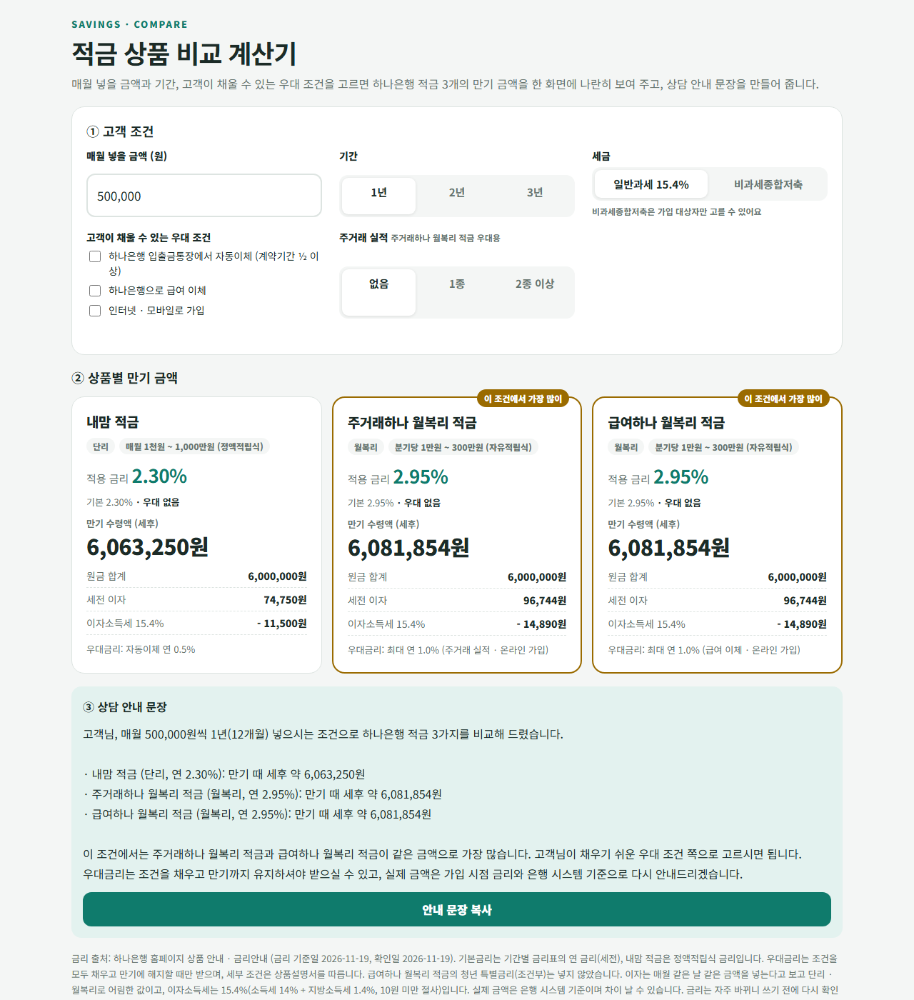

# 적금 상품 비교 계산기 (예적금 만기계산기 v2)

## 한 줄 소개

매월 넣을 금액 · 기간 · 고객이 채울 수 있는 우대 조건을 고르면 하나은행 적금 3개의 세후 만기 금액을 나란히 보여 주고 상담 안내 문장을 만들어 주는 계산기

## 어떤 불편을 줄이나요

"어떤 적금이 나아요?"라고 물으면 상품마다 금리표와 우대 조건을 따로 열어 보고 머릿속으로 비교했어요. 계산은 은행 시스템에도 있지만, **고객 조건에 맞춰 여러 상품을 한 화면에 나란히 놓는 것**은 없어서 직접 만들었어요.

## 꼭 필요한 기능

- 고객 조건 입력 → 상품 3개 만기 금액 나란히
- 우대 조건 체크 → 상품별 적용 금리 자동 반영
- 비교 안내 문장 복사

## 아낄 수 있는 시간

(예시 가정) 적금 비교 상담 한 건에 5분쯤. 실제로 얼마나 아끼는지는 써 보고 적어요.

## AI로 이렇게 만들었어요

1. 하나은행 홈페이지의 적금 상품 안내 · 금리안내를 AI에게 읽혀서, 판매 중인 상품 3개의 기간별 금리 · 우대 조건 · 한도를 표로 정리했어요 (확인일 2026-11-19)
2. 은행연합회 소비자포털 공시와 기본금리를 맞춰 봤어요
3. 그 표를 `prd.md`에 넣고 Codex에 "이 세 상품을 나란히 비교하는 계산기"를 만들게 했어요
4. `test.md`로 숫자를 검수했어요

홈페이지는 금리 박스를 화면에서 그려 넣고, 자동 수집을 막아 둔 주소도 있어요. 그래서 도구가 실시간으로 긁어 오지 않고, **사람이 확인한 금리를 코드 맨 위 표에 넣는 방식**으로 했어요. 금리가 바뀌면 그 표만 고치면 돼요.

## 써 보는 법

- `index.html`을 더블클릭해서 열어요
- 급여 이체 · 온라인 가입을 체크해서 급여하나 월복리 적금이 앞서는지 보기
- 매월 120만원을 넣어서 월복리 두 상품의 분기 한도 안내가 나오는지 보기
- `test.md`로 검수해 보기

## 배포 주소

## 화면

## 다음에 붙이고 싶은 기능

- 내맘 적금의 6개월 · 5년 같은 다른 기간
- 정기예금 상품 비교
