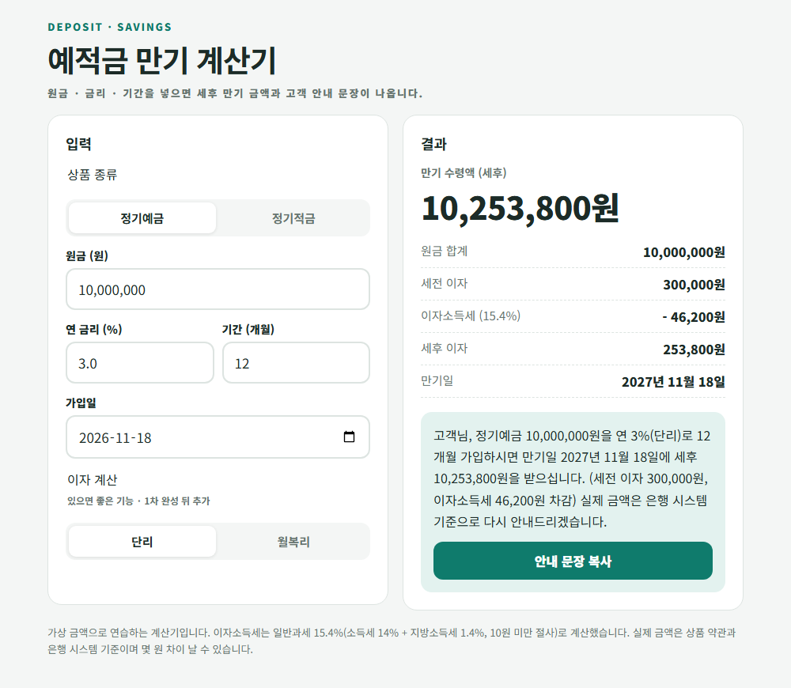

# 예적금 만기 계산기

## 한 줄 소개

원금 · 금리 · 기간을 넣으면 세후 만기 수령액과 고객 안내 문장을 바로 보여 주는 계산기

## 어떤 불편을 줄이나요

고객이 만기 금액을 물을 때마다 계산기로 이자 · 세금 · 수령액을 따로 계산하고, 그 숫자를 안내 문장으로 다시 옮겨 적었어요.

## 꼭 필요한 기능

- 원금 · 금리 · 기간 입력칸
- 세후 수령액 표시
- 안내 문장 복사 버튼

## 아낄 수 있는 시간

매주 1시간

## 써 보는 법

- `index.html`을 더블클릭해서 열어요
- 정기예금 10,000,000원 · 연 3.0% · 12개월 → 세후 10,253,800원이 나오는지 보기
- 정기적금으로 바꾸고 월 납입액 500,000원 → 세후 6,082,490원
- 안내 문장 복사 → 메모장에 붙여 넣기
- 단리 ↔ 월복리를 바꿔 보기 (있으면 좋은 기능을 1차 완성 뒤 붙인 것)
- `test.md`의 9개 항목으로 검수해 보기

## 배포 주소

## 화면

## 다음에 붙이고 싶은 기능

- 월별 이자 표
- 비과세 선택
