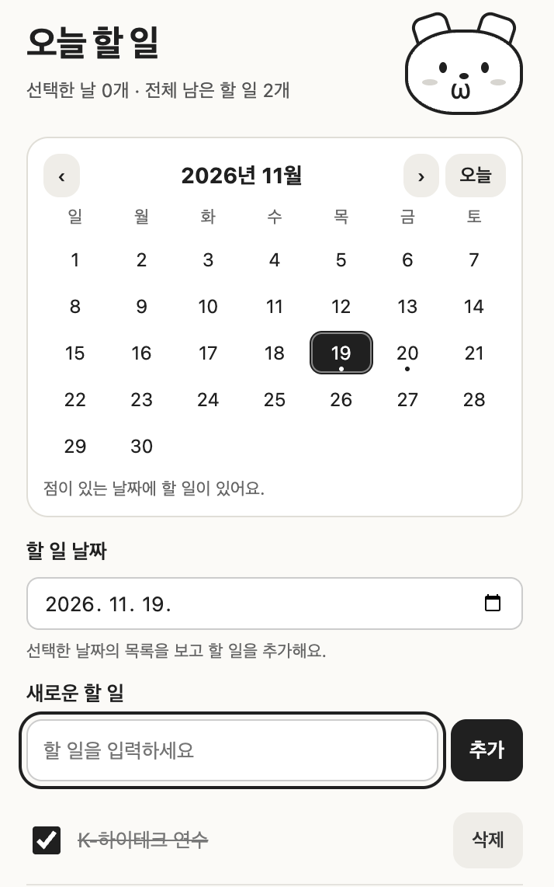
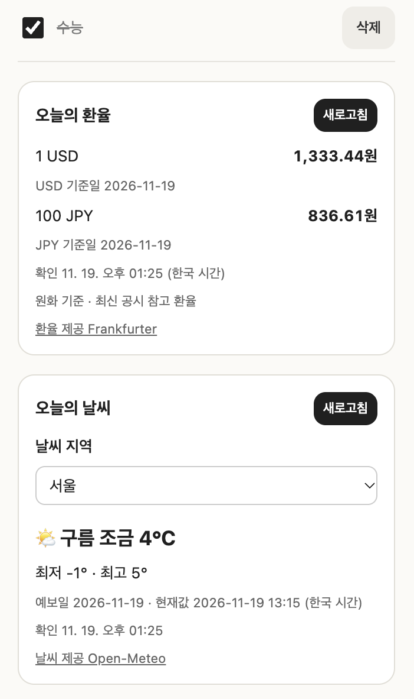

# 오늘 할 일 + 환율·날씨

## 한 줄 소개

날짜별 할 일을 관리하고 오늘의 환율·날씨를 한 곳에서 확인하는 크롬 확장 프로그램입니다.

## 누구를 위해 만들었나요

오늘의 할일, 환율, 날씨가 궁금한 사람을 위해 만들었습니다.

## 주요 기능

- 날짜별 할 일 추가·완료·삭제, 남은 개수 표시와 캘린더, 목록 자동 저장
- 최신 공시 USD·JPY 환율과 공시 기준일 확인
- 지역별 현재·최저·최고 기온 확인과 지역 선택 저장

## 화면

## 강사 예시에서 바꾼 점

대화에서 요청한 기능을 차례로 추가하며 만들었습니다.

- 빈칸과 중복 할 일 추가 방지, 50자 초과 안내
- 날짜별 목록과 월별 캘린더
- 폭 360px, 작은 글씨, 검정색 포인트와 직접 구성한 고양이 캐릭터
- 환율·날씨 조회

## 만들면서 배운 점

간편하게 사용할 수 있을것같다!
