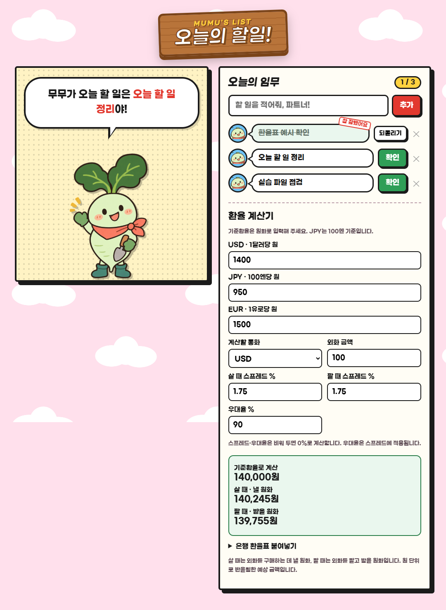

# 오늘의 할일!

## 한 줄 소개

새싹 캐릭터 무무와 함께 할 일을 관리하고, 입력한 환율로 외화 매매 금액을 계산하는 크롬 확장 프로그램입니다.

## 누구를 위해 만들었나요

할 일과 예시 환율 계산을 한곳에서 확인하고 싶은 외환·송금 업무 담당자입니다.

## 주요 기능

- 할 일을 추가하고 완료하거나 되돌리고 삭제할 수 있습니다. 완료하면 무무가 말풍선과 애니메이션으로 칭찬합니다.
- USD, JPY, EUR 기준환율을 직접 입력하거나 표에서 붙여넣고, 스프레드와 우대율을 반영해 예상 원화 금액을 확인할 수 있습니다.
- 팝업과 크게 보기 화면에서 사용할 수 있고, 할 일과 환율 입력값을 브라우저에 저장합니다.

## 화면

## 강사 예시에서 바꾼 점

- 캐릭터가 할 일을 안내하고 완료를 축하합니다.
- 환율표 붙여넣기와 우대율을 반영한 계산 기능을 추가했습니다.
- 제출용 사본에 새싹 캐릭터 무무와 그 캐릭터를 사용한 확장 프로그램 아이콘을 넣었습니다.

## 만들면서 배운 점
