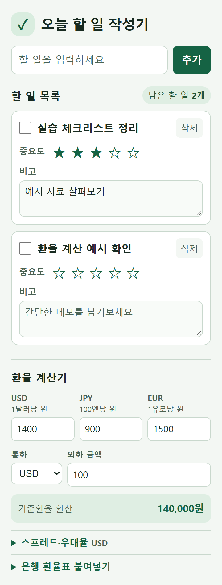

# 오늘 할 일 작성기

## 한 줄 소개

할 일과 메모를 정리하고, 외화 금액을 원화로 환산하는 크롬 확장 프로그램입니다.

## 누구를 위해 만들었나요

제가 매일 할 일을 정리하고 필요할 때 환율을 계산할 수 있도록 만들었습니다.

## 주요 기능

- 할 일을 추가·완료·삭제하고 남은 할 일 수를 확인합니다. 각 항목에 별점과 메모를 남길 수 있습니다.
- 달러(USD), 엔(JPY), 유로(EUR)를 원화로 환산하고, 스프레드와 우대율을 반영해 살 때와 팔 때의 금액을 계산합니다.
- 은행 환율표에서 통화와 매매기준율을 복사해 붙여넣을 수 있습니다.

## 화면

## 강사 예시에서 바꾼 점

- 기본 할 일 예제에 중요도 별점, 항목별 메모, 완료 축하 애니메이션을 추가했습니다.
- 환율 계산 영역에 스프레드와 우대율 설정, 환율표 붙여넣기를 넣었습니다.

## 만들면서 배운 점

코드를 직접 짜지 않아도 이렇게 쉽게 응용 프로그램을 만들 수 있다는 걸 배웠습니다.
