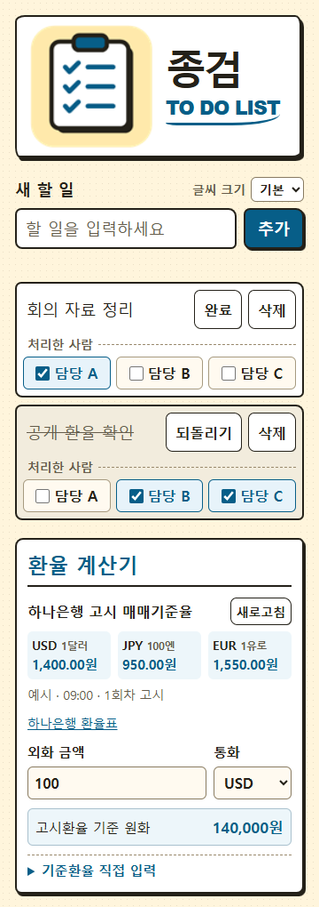

# 종검 TO DO LIST

## 한 줄 소개

종검 업무의 할 일과 담당자별 처리 여부를 기록하고, 하나은행 고시환율로 외화 금액을 원화로 환산하는 크롬 확장 프로그램이에요.

## 누구를 위해 만들었나요

종검 업무 파트 직원들을 위해 만들었어요.

## 주요 기능

- 할 일을 추가·완료·삭제할 수 있어요. 중복 등록을 막고 50자를 넘으면 안내해요.
- 할 일마다 담당자별로 처리 여부를 체크할 수 있고, 목록과 체크 상태는 팝업을 다시 열어도 유지돼요.
- USD·JPY·EUR의 하나은행 고시 매매기준율과 고시 시각을 표시하고, 입력한 외화 금액을 원화로 환산해요.

## 화면

## 강사 예시에서 바꾼 점

- 담당자별 처리 체크칸과 글씨 크기 조절 메뉴를 추가했어요.
- 하나은행 매매기준율을 조회해 원화로 환산하고, 필요하면 직접 입력한 기준환율도 사용할 수 있게 만들었어요.

## 만들면서 배운 점

누구나 할 수 있다
