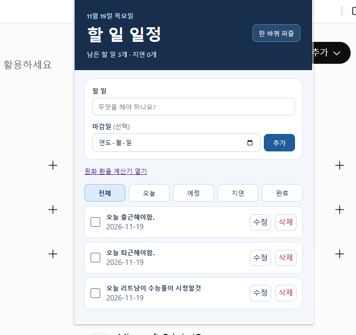

# 오늘 할 일 작성기

<!-- 맨 위 "확장 프로그램 이름"을 내 확장 프로그램 이름으로 바꿔 주세요. 예) # 오늘 할 일 + 환율 계산기
     ## 으로 시작하는 제목 줄은 바꾸지 마세요. 대시보드가 제목으로 내용을 찾아요.
     회색 안내문(<!-- -->)은 지워도 되고 남겨도 돼요. 화면에는 안 보여요. -->

## 한 줄 소개

할 일과 마감일을 관리하고, Gmail에서 할 일을 추가할 수 있는 크롬 확장 프로그램입니다.

## 누구를 위해 만들었나요

<!-- 어떤 사람이, 어떤 순간에 쓰면 좋은지. 예) 창구에서 환전 문의를 자주 받는 사람 -->

## 주요 기능

<!-- 3개 안팎. 한 줄에 하나씩, 맨 앞에 - 를 붙여요. -->
- 할 일 등록, 완료 처리 및 마감일별 분류
- Gmail에서 보고 있는 메일을 할 일에 추가
- 원화 환율 계산기와 한 바퀴 퍼즐

## 화면

<!-- screenshot.png 는 꼭 넣어 주세요(대시보드 대표 사진). 더 있으면 screenshot-2.png, screenshot-3.png. 없는 줄은 지워요. -->

## 강사 예시에서 바꾼 점

<!-- Codex로 무엇을 고치고 더했는지. 예) 마감 체크 프리셋을 붙였고, 긴 할 일이 줄바꿈되게 고쳤어요 -->
- 

## 만들면서 배운 점

<!-- 막혔던 점, 3줄 공식으로 고친 오류 등 한두 줄 -->
