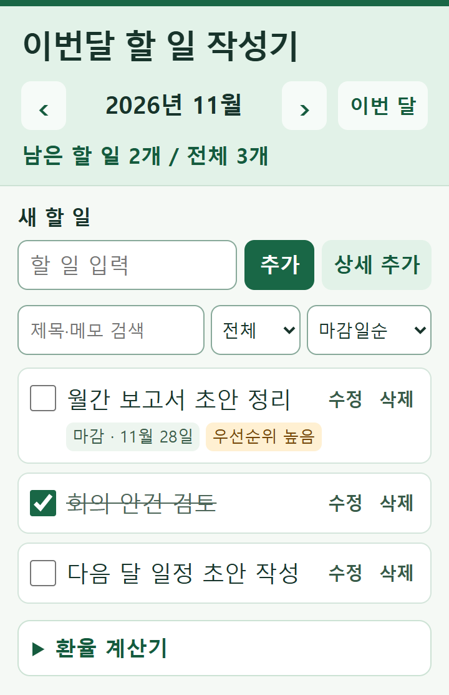

# 이번달 할 일 작성기

## 한 줄 소개

월별 보고와 회의 일정을 챙기고, 입력한 환율로 외화의 원화 금액도 계산할 수 있는 크롬 확장 프로그램입니다.

## 누구를 위해 만들었나요

월별 보고와 회의 일정을 챙기는 본부·기획 담당자를 위해 만들었습니다.

## 주요 기능

- 월별 할 일을 추가하고, 예정일·마감일·우선순위·메모를 기록합니다.
- 제목과 메모를 검색하고, 완료 상태로 걸러 보거나 마감일·예정일·우선순위로 정렬합니다.
- USD·JPY·EUR 기준환율을 직접 입력하거나 표에서 붙여넣어 원화 환산액을 계산합니다. 스프레드와 우대율을 입력하면 외화를 살 때와 팔 때의 금액도 계산합니다.

## 화면

## 강사 예시에서 바꾼 점

- 기본 할 일 목록에 월 이동, 일정 관리, 검색과 정렬을 추가했습니다.
- 환율표에서 기준환율을 읽어 오는 기능과 스프레드·우대율을 반영하는 계산기를 넣었습니다.

## 만들면서 배운 점

필요한 기능을 하나씩 말로 요청하면 AI로도 직접 업무 도구를 만들 수 있다는 걸 배웠습니다.
