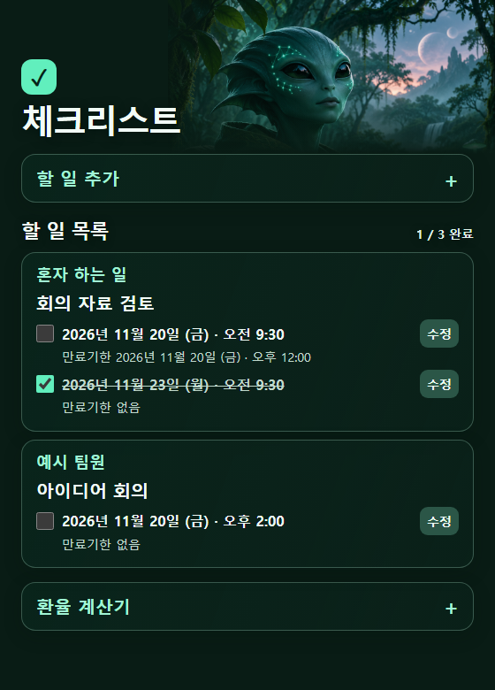

# 체크리스트

## 한 줄 소개

오늘 할 일과 여러 날짜의 일정을 정리하고, 원화와 외화 금액을 계산할 수 있는 크롬 확장 프로그램이다.

## 누구를 위해 만들었나요

날짜별 일정을 놓치지 않고, 혼자 할 일과 함께하는 일을 한곳에서 확인하려는 사람을 위해 만들었다.

## 주요 기능

- 한 가지 할 일에 여러 날짜를 추가하고, 날짜별로 시간과 완료 여부를 관리한다.
- 같이하는 사람별로 일정을 모아 보여 주고, 설정한 만료기한이 지났는지 표시한다.
- 하나은행 고시 환율을 조회해 원화와 외화 금액을 양방향으로 계산한다.

## 화면

1.6.1에는 제출용으로 새로 만든 외계인 배경 이미지를 포함한다. 팝업 상단에 그림을 배치해 일정 목록과 제목을 읽기 쉽게 했다.

## 강사 예시에서 바꾼 점

할 일을 사람별로 묶고 날짜별 완료 표시와 만료기한을 추가했다. 환율 계산기를 같은 팝업에서 펼쳐 쓸 수 있다.

## 만들면서 배운 점

할 일 제목과 날짜별 일정을 나누어 저장하면 반복 일정도 날짜마다 따로 완료 처리할 수 있다.
