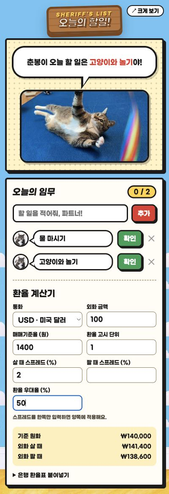

# 춘봉이와 오늘의 할일! + 환율 계산기

## 한 줄 소개

춘봉이 사진과 함께 할 일을 관리하고, 외화 금액을 원화로 계산하는 크롬 확장 프로그램입니다.

## 누구를 위해 만들었나요

고양이를 좋아하고 할 일과 환율을 함께 관리하고 싶은 사람을 위해 만들었습니다.

## 주요 기능

- 할 일 추가·완료·되돌리기·삭제와 춘봉이 사진을 활용한 칭찬 화면
- 통화별 기준환율·고시 단위·스프레드·우대율에 따른 원화 환산
- 은행 환율표 붙여넣기와 입력값 자동 저장

## 화면

## 강사 예시에서 바꾼 점

- 우디 이미지 세 장을 춘봉이 사진으로 교체했습니다.
- 할 일 목록 아래에 환율 계산기를 추가했습니다.
- 통화별 입력값을 저장하고 은행 표를 읽어 채우도록 했습니다.
- 사진 출처는 [언더월드 놀이 영상](https://www.youtube.com/watch?v=bJIxetYq07w), [아침 요가 영상](https://www.youtube.com/watch?v=A9HZ3Cxe0Vg), [공식 스토어](https://underworld01.cafe24.com/surl/p/20)입니다.

## 만들면서 배운 점

고양이 최고
