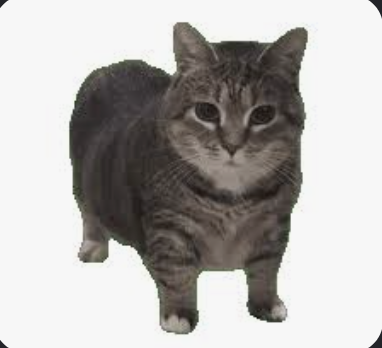

# 오늘 할일 + 환율 계산기

## 한 줄 소개

고양이 반응과 함께 할 일을 자동 시간표로 관리하고, 외화 금액을 원화로 계산하는 크롬 확장 프로그램.

## 누구를 위해 만들었나요

할 일의 순서와 예상 시간을 정리하고 환율 계산도 한곳에서 하고 싶은 사람을 위한 도구입니다.

## 주요 기능

- 할 일·예상 시간 입력, 자동 시간표 배치, 완료·되돌리기와 이전 할 일 가져오기
- 고양이 반응·효과음, 시작 시간 알림과 브라우저 내 자동 저장
- USD·JPY·EUR 환율 계산, 스프레드·우대율 적용 및 환율표 붙여넣기

## 화면

## 강사 예시에서 바꾼 점

- 참고 투두 프로젝트를 바탕으로 고양이 반응과 효과음, 자동 시간표와 알림을 구성했습니다.
- 환율 계산기와 은행 환율표 붙여넣기 기능을 추가했습니다.

## 만들면서 배운 점

아직 작성하지 않았습니다.

## 사용 자료 출처

- 해피캣 영상·음성: https://mem.video/mem/happy-happy-happy-cat-kot-prygaet-izhahxbjhk
- Huh 고양이 영상: https://makeagif.com/gif/green-screen-huh-cat-meme-4SAdXu
- 우는 고양이 음성: https://www.myinstants.com/en/instant/cry-banana-cat-84043/
- 우웩 고양이 음성: https://www.myinstants.com/en/instant/cat-vs-durian-45484/
- Huh 고양이 음성: https://www.myinstants.com/en/instant/huh-cat-21280/
- PNG 사진: 사용자가 제공한 자료이며 원본 출처는 확인하지 못했습니다.
- 위 밈 자료의 별도 재배포 허용 라이선스는 확인하지 못했습니다.
- 폰트: Bithumb Gothic Basic. fonts/LICENSE.txt 참고.

