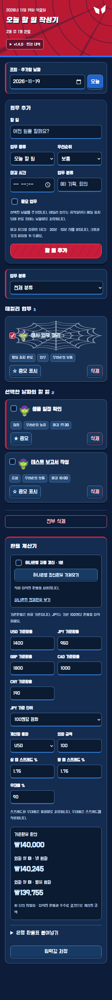

# 오늘 할 일 작성기 + 환율 계산기

## 한 줄 소개

날짜별 할 일을 관리하고 하나은행 기준환율로 외화 금액을 원화로 계산하는 크롬 확장 프로그램입니다.

## 누구를 위해 만들었나요

나를 위해 만들었어

## 주요 기능

- 데일리 업무·날짜별 할 일 추가, 완료, 중요 표시, 우선순위·마감·분류 설정 및 저장
- 마감 1시간·30분·10분 전 알림, 같은 제목 묶기, 전체 삭제
- USD·JPY·GBP·CAD·CNY 원화 환산, 스프레드·우대율 계산, 은행 표 붙여넣기와 하나은행 최신 고시 조회

## 화면

대표 화면은 예시 데이터를 넣어 렌더링한 제출용 미리보기입니다.

## 강사 예시에서 바꾼 점

- 말로 요청해 만든 확장 프로그램에 날짜별 조회, 중복 업무 묶기, 알림, 버전·변경 내역 표시를 추가했습니다.
- 빨강·파랑 테마, 직접 작성한 얼굴 아이콘, 완료 시 거미줄 표시를 적용했습니다.
- 하나은행 공식 현재환율을 열 때 조회하고, 열린 동안 1분마다 갱신하도록 연결했습니다.
- 직접 환율을 바꾸면 자동 갱신이 꺼지며, 입력한 환율·금액·수수료 조건이 저장됩니다.

## 만들면서 배운 점

좀더 세부적인걸 전부 말해줘야된다는걸 알았어
