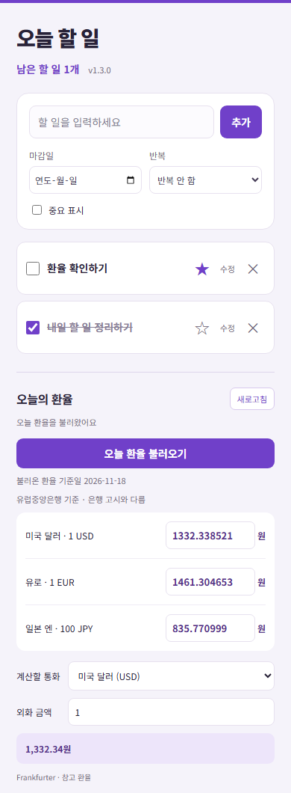

# 오늘 할 일 작성기

## 한 줄 소개

할 일을 관리하고 USD·JPY·EUR 금액을 원화로 환산하는 Chrome 확장 프로그램입니다.

## 누구를 위해 만들었나요

할 일과 외화 환산 금액을 한 화면에서 확인하고 싶은 외환·송금 업무 담당자를 위한 실습용 도구입니다.

## 주요 기능

- 할 일 추가·수정·완료·삭제 및 남은 할 일 개수 표시
- 중요 표시, 마감일, 매일·매주 반복 설정
- USD·JPY·EUR 기준환율 불러오기 및 직접 입력, 원화 환산. 일본 엔은 100엔 기준으로 표시합니다.

## 화면

## 강사 예시에서 바꾼 점

- 기본 할 일 작성기에 수정, 중요 표시, 마감일과 반복을 추가했습니다.
- 보라색 카드 디자인을 적용하고, Frankfurter에서 가져온 유럽중앙은행 기준환율과 기준일을 표시했습니다.

## 만들면서 배운 점

환율을 계산할 때는 통화별 기준 단위를 확인해야 합니다. 엔화는 100엔당 원화 기준환율을 사용하고, 입력한 엔화 금액을 100으로 나누어 환산합니다.
