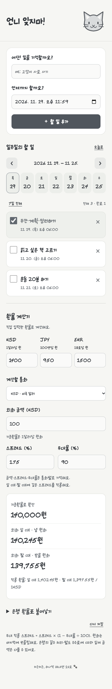

# 언니 잊지마!

## 한 줄 소개

이번 주 할 일을 마감순으로 체크하고, 외화 금액도 원화로 계산하는 고양이 테마 크롬 확장 프로그램입니다.

## 누구를 위해 만들었나요

시루보스가 이번 주 할 일을 체크하기 위해 만들었습니다.

## 주요 기능

- 할 일과 마감 날짜·시간을 등록하고, 7일 단위로 마감이 가까운 순서대로 조회합니다. 같은 이름의 할 일은 중복 등록을 막고, 완료 체크 시 취소선을 표시합니다.
- USD·JPY·EUR 기준환율과 스프레드·우대율을 직접 입력해 원화 환산액과 외화 살 때·팔 때의 금액을 계산합니다. 은행 환율표를 붙여넣으면 식별한 기준환율을 통화별로 채웁니다.
- 할 일과 환율 입력값을 브라우저에 저장합니다. 폭 360px의 한국어 화면에 회색 고양이와 제임스네일체를 적용했습니다.

## 화면

## 강사 예시에서 바꾼 점

- 사용자 요청으로 ‘언니 잊지마!’를 제작하고, 회색 고양이 테마와 큰 글씨를 적용했습니다.
- 마감순 정렬, 중복 방지, 주간 날짜 이동, 완료 체크를 넣었습니다.
- 환율 계산, 은행 표 붙여넣기, 통화별 입력값 저장을 추가했습니다.
- 실제 확장 프로그램 환경에서 글꼴 적용을 검사하고, 본문에 폰트를 직접 지정해 시스템 글꼴로 표시되던 문제를 수정했습니다.

## 만들면서 배운 점

일반 HTML에서 정상으로 보여도 크롬 확장 프로그램에서는 본문 기본 글꼴 때문에 다른 결과가 나올 수 있었습니다. 실제 확장 프로그램 환경에서 글꼴 로딩과 적용 상태를 따로 확인해야 한다는 점을 확인했습니다.

크롬 설치: chrome://extensions → 개발자 모드 → ‘압축해제된 확장 프로그램을 로드합니다’ → 이 폴더 선택.

엔화 기준환율은 100엔당 원화입니다. 환율을 자동 조회하지 않으며, 양방향에 동일한 스프레드를 적용하고 최종 원화만 반올림합니다. 실제 은행의 끝수 처리·별도 수수료는 다를 수 있습니다. 폰트는 그리운 GRIUN의 제임스네일체로, 배포 안내상 개인 비상업 용도입니다(fonts/README.txt 참고).
