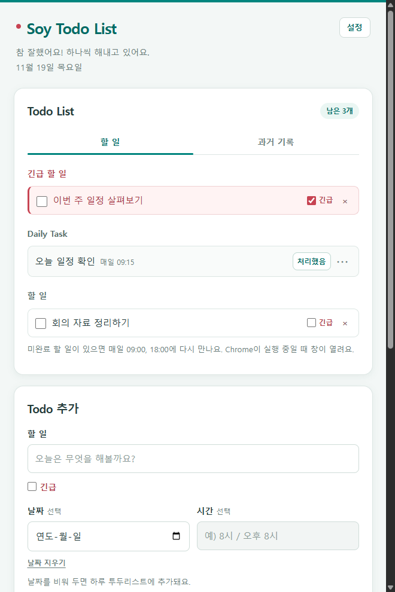

# Soy Todo List

## 한 줄 소개

오늘 할 일과 매일 반복하는 일을 한 화면에서 관리하는 Chrome 확장 프로그램입니다.

## 누구를 위해 만들었나요

매일 정해진 시간에 반복 업무를 챙기고, 미완료 할 일과 예정된 일정을 함께 보고 싶은 사람을 위한 도구입니다.

## 주요 기능

- 오늘 할 일을 추가하고 완료 표시하거나 삭제할 수 있어요. 미완료 항목은 다음 날 목록에도 표시돼요. 완료 항목은 과거 기록 탭에서 7일 동안 볼 수 있고, 체크를 해제하면 할 일로 돌아와요.
- 매일 반복할 일의 시간을 정하면 Chrome이 실행 중일 때 알림 창과 차임 소리로 알려 줘요. 목록에서 당일 처리 표시를 할 수 있어요.
- 날짜가 있는 할 일은 Google Calendar에 일정으로 등록할 수 있어요. 이 기능을 사용하려면 OAuth 클라이언트 ID를 설정하고 Google 계정을 연결해야 해요.

## 화면

## 강사 예시에서 바꾼 점

- 반복 알림과 일반 할 일을 한 목록에 모았어요.
- 캘린더 등록과 실패한 일정의 재시도 기능을 추가했어요.
- 할 일과 과거 기록을 탭으로 나누고, 7일이 지난 완료 항목은 자동으로 정리하도록 바꿨어요.
- 긴급 할 일을 목록 맨 위에 표시하고, 반복 업무 행에 처리 버튼과 메뉴를 추가했어요.
- 버전 1.5.0에서 할 일 화면과 반복 업무 알림 창의 디자인을 정리했어요.
- 버전 1.5.1에서 확장 프로그램 아이콘을 새 체크 아이콘으로 바꿨어요.

## 만들면서 배운 점

Chrome에서 예시 할 일을 완료하면 과거 기록으로 이동하고, 체크를 해제하면 할 일 탭으로 돌아오는지 확인했어요.
