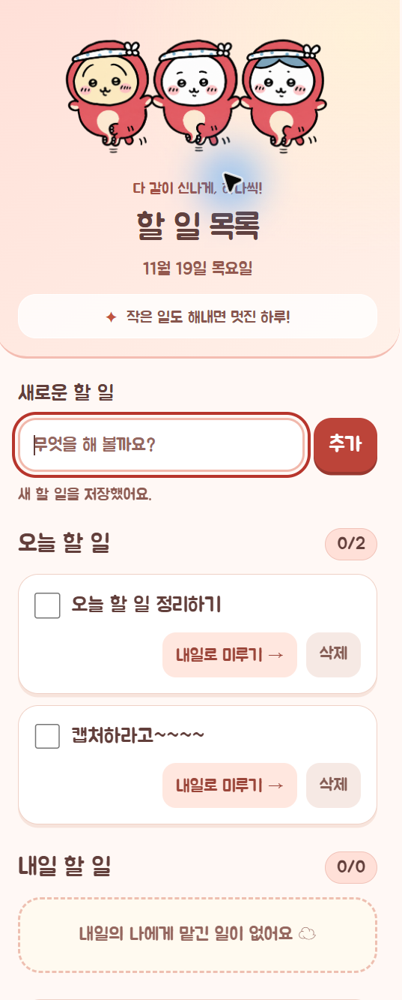

# TODO List · 할 일과 환율 계산기

<!-- 맨 위 "확장 프로그램 이름"을 내 확장 프로그램 이름으로 바꿔 주세요. 예) # 오늘 할 일 + 환율 계산기
     ## 으로 시작하는 제목 줄은 바꾸지 마세요. 대시보드가 제목으로 내용을 찾아요.
     회색 안내문(<!-- -->)은 지워도 되고 남겨도 돼요. 화면에는 안 보여요. -->

## 한 줄 소개

할 일을 관리하고 외화 금액을 원화로 계산하는 크롬 확장 프로그램입니다.

## 누구를 위해 만들었나요

기왕 볼 거, 귀여운 디자인을 넣어서 보고 싶었던 나 자신을 위해 만들었습니다.

## 주요 기능

<!-- 3개 안팎. 한 줄에 하나씩, 맨 앞에 - 를 붙여요. -->
- 할 일 추가·완료 체크·내일로 미루기·삭제와 목록 자동 저장
- 외화 금액의 원화 환산, 스프레드·우대율을 반영한 살 때·팔 때 계산, 은행 환율표 가져오기
- Frankfurter에서 JPY 환율 불러오기, 환율 날짜·출처 표시와 입력값 저장

## 화면

<!-- screenshot.png 는 꼭 넣어 주세요(대시보드 대표 사진). 더 있으면 screenshot-2.png, screenshot-3.png. 없는 줄은 지워요. -->

## 강사 예시에서 바꾼 점

<!-- Codex로 무엇을 고치고 더했는지. 예) 마감 체크 프리셋을 붙였고, 긴 할 일이 줄바꿈되게 고쳤어요 -->
- 직접 요청하며 만든 화면에 문어옷 캐릭터 일러스트와 코랄·붉은색 테마, 배민 주아체를 적용했습니다.
- 내일로 미루기와 통화별 환율 저장, 은행 표 미리보기, JPY 환율 불러오기를 함께 구성했습니다.

## 만들면서 배운 점

코덱스를 처음 사용해서 조금 어렵긴 했지만, 개인 GPT보다 더 잘 만들어 주는 것 같아서 재미있었습니다.
