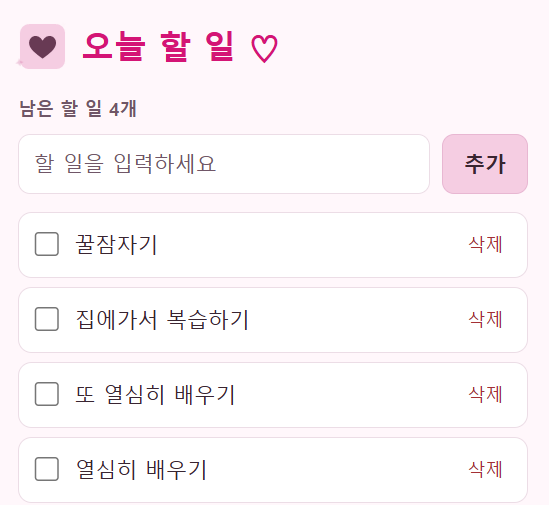

# 오늘 할 일 작성기 ♡

## 한 줄 소개

할 일과 Gmail에서 가져온 메일을 한곳에 정리하고, 환율과 날씨도 확인할 수 있는 크롬 확장 프로그램입니다.

## 누구를 위해 만들었나요

할 일을 한곳에서 정리하고 싶은 동료를 위해 만들었어요.

## 주요 기능

- 할 일을 추가하고 완료 표시하거나 삭제합니다. 목록은 창을 닫아도 저장됩니다.
- Gmail에서 열린 메일을 할 일에 추가하고, 목록에서 원래 메일을 다시 열 수 있습니다.
- 원화 기준 환율을 확인하고 환전 금액을 계산하며, 선택한 도시의 날씨를 볼 수 있습니다.

## 화면

## 강사 예시에서 바꾼 점

- 할 일 창에 분홍색 디자인과 하트 아이콘을 적용했습니다.
- Gmail 연동, 환율 계산, 도시별 날씨 확인을 한 확장 프로그램에 모았습니다.

## 만들면서 배운 점

제가 말만 하면 뚝딱 만들어주는게 신기했어요.
