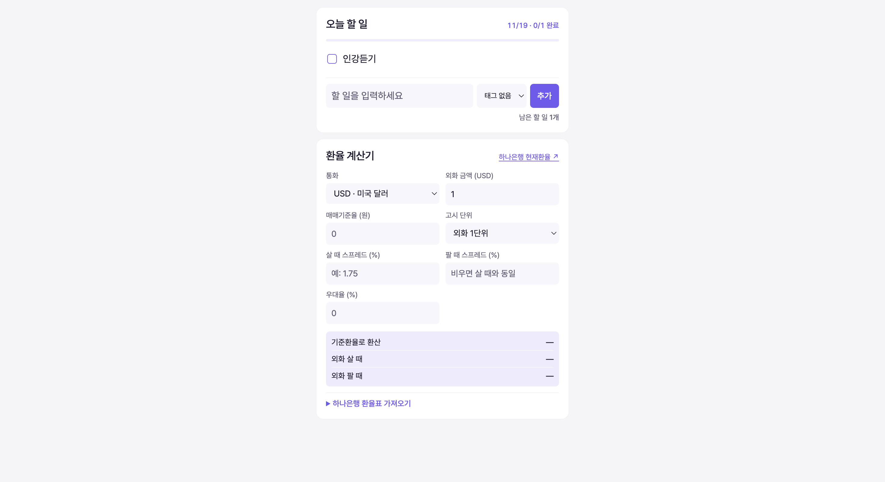

# 오늘 할 일 작성기 + 환율 계산기

## 한 줄 소개

오늘 할 일을 정리하고 외화 환전 금액을 계산하는 크롬 확장 프로그램입니다.

## 누구를 위해 만들었나요

제가 직접 쓰려고 만들었어요.

## 주요 기능

- 할 일을 추가하고 태그를 붙이거나 완료 표시할 수 있어요.
- 오늘 날짜와 완료율, 남은 할 일 개수를 확인할 수 있어요.
- 환율과 우대율을 입력해 외화를 살 때와 팔 때의 원화 금액을 계산할 수 있어요.

## 화면

## 강사 예시에서 바꾼 점

- 할 일에 태그와 완료율 표시를 추가했어요.
- 환율 계산기를 별도 영역으로 나누고, 환율표를 붙여 넣는 기능을 넣었어요.

## 만들면서 배운 점

분리해서 만들기
