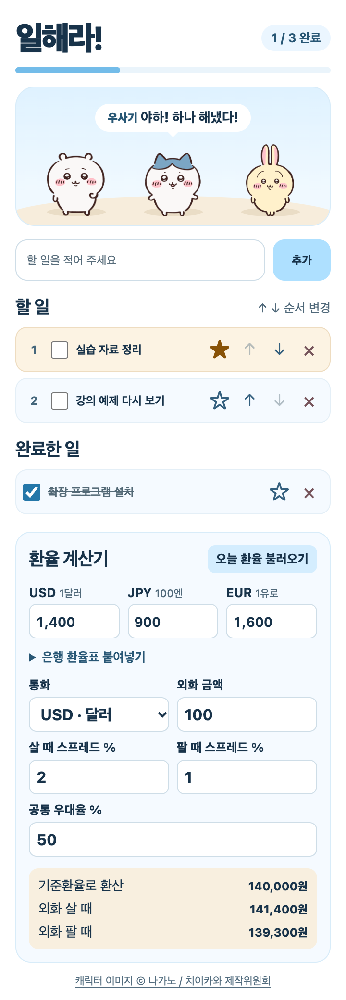

# 일해라!

## 한 줄 소개

할 일을 정리하고, 같은 크롬 팝업에서 외화를 원화로 계산하는 확장 프로그램이에요.

## 누구를 위해 만들었나요

나를 위해 만들었어요.

## 주요 기능

- 할 일 추가, 완료 체크, 별표, 처리 순서 변경, 삭제를 지원하며 목록을 자동 저장해요.
- USD·JPY·EUR의 기준환율로 원화 금액을 계산하고, 스프레드와 우대율을 입력하면 외화를 살 때와 팔 때의 금액도 보여 줘요.
- 은행 환율표를 붙여넣거나 Frankfurter에서 유럽중앙은행 기준환율을 불러올 수 있어요. 환율 입력값도 자동 저장해요.

## 화면

## 강사 예시에서 바꾼 점

- 완료 응원과 마지막 할 일을 끝냈을 때의 축하 애니메이션을 넣었어요.
- 할 일 목록 아래에 환율 계산기를 추가하고, 외화 금액과 스프레드 입력에 따라 결과가 바로 바뀌게 만들었어요.

## 만들면서 배운 점

중간중간 잘 만들어졌는지 코덱스 혼자 확인하고 나한테 안보여줘서 불안했어요
