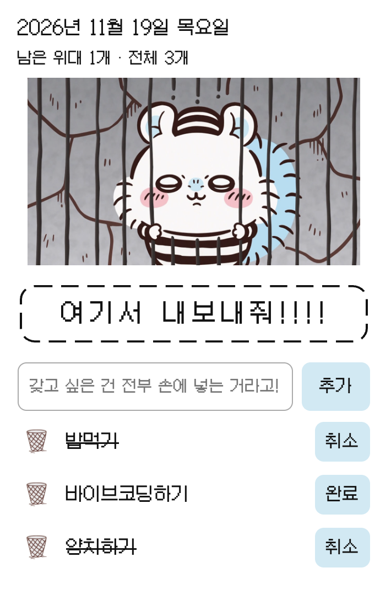

# 토벌? 무서워랏~

## 한 줄 소개

직접 만든 캐릭터와 함께 할 일을 추가하고 완료 여부를 관리하는 크롬 확장 프로그램

## 누구를 위해 만들었나요

나

## 주요 기능

- 할 일 추가·완료·취소·삭제와 자동 저장
- 오늘 날짜와 남은 할 일·전체 개수 표시
- 완료 상태에 따라 캐릭터 그림과 움직이는 문구 변경

## 화면

## 강사 예시에서 바꾼 점

- 직접 만든 캐릭터 그림과 아이콘을 적용했어요.
- 픽셀 글꼴과 하늘색 버튼으로 화면을 꾸몄어요.
- 남은 할 일에 따라 그림과 문구가 바뀌게 했어요.
- 빈 입력·중복 할 일·50자 초과 입력을 확인해요.

## 만들면서 배운 점

크롬 확장 프로그램 만들기 재밌다
