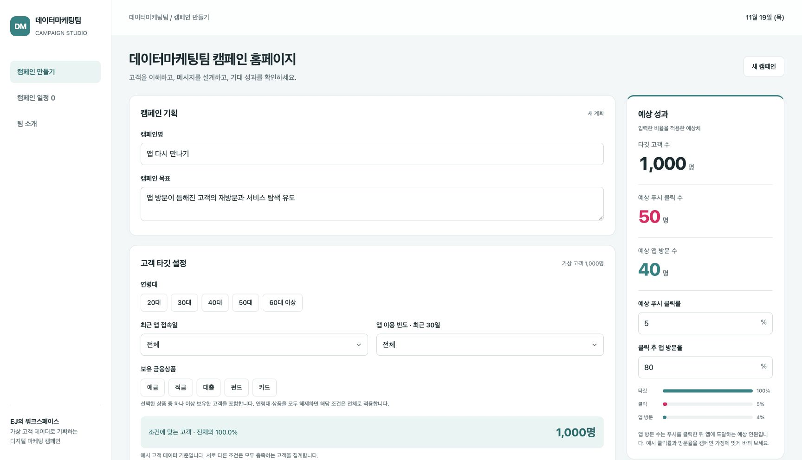

# 데이터마케팅팀 캠페인 홈페이지

## 한 줄 소개

고객 데이터를 분석해 마케팅 성과를 높이는 팀의 캠페인 기획 웹앱입니다.

## 누구를 위해 만들었나요

디지털 마케팅 담당자, 경영진·리더, 협업 부서가 앱 이용 활성화 캠페인을 기획하고 검토할 수 있도록 만들었습니다.

## 페이지 구성

- 캠페인 만들기 · 기획, 연령대·최근 앱 접속일·앱 이용 빈도·보유 금융상품 타깃 설정
- 푸시 메시지 작성·모바일 알림 미리보기와 예정 일정 저장
- 예상 푸시 클릭 수·앱 방문 수 시뮬레이션
- 캠페인 일정 · 저장한 계획 조회·수정
- 팀 소개 · 데이터마케팅팀의 역할과 사용자

가상 고객 1,000명을 사용하며 입력값과 계획은 현재 브라우저에 저장됩니다. 일정은 발송 계획으로 관리합니다.

## 배포 주소

https://teampagemarketing-campaign.vercel.app/

## 화면

## 만들면서 배운 점

<!-- 사용 후 EJ가 작성할 예정입니다. -->
