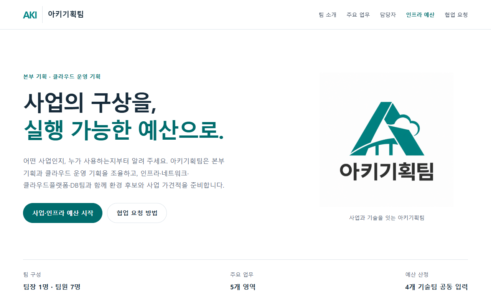

# 아키기획팀

## 한 줄 소개

본부 기획과 클라우드 운영 기획을 조율하고, 사업 설명부터 인프라 예산 산정까지 연결하는 가상 팀의 홈페이지입니다.

## 누구를 위해 만들었나요

팀의 업무별 담당자를 확인하고 협업을 요청하려는 유관 부서 담당자를 위해 만들었습니다.

## 페이지 구성

- 팀 소개와 인프라 예산 작업 바로가기
- 주요 업무 5개 영역과 담당자 연결
- 사업 설명·환경 검토·기술팀별 예산 입력·가견적 확인 흐름
- 팀장 1명과 팀원 7명의 가상 담당자 소개
- 협업 요청 방법과 요청문 생성·복사
- 별도 인프라 예산 화면의 3티어·이중화 기준, 장비 선택, 수량·단가 입력, 가견적과 CSV·JSON 내려받기

## 배포 주소

https://arch-teampage-test.vercel.app/

## 화면

## 만들면서 배운 점

사업 설명부터 인프라 예산 산정까지 연결하는 홈페이지를 만들 수 있다는 걸 배웠어요.

Vercel 배포는 정적 소개 화면 기준이며, 공동 예산의 공유 저장과 동시 편집에는 별도 API·데이터베이스 연결이 필요합니다.
