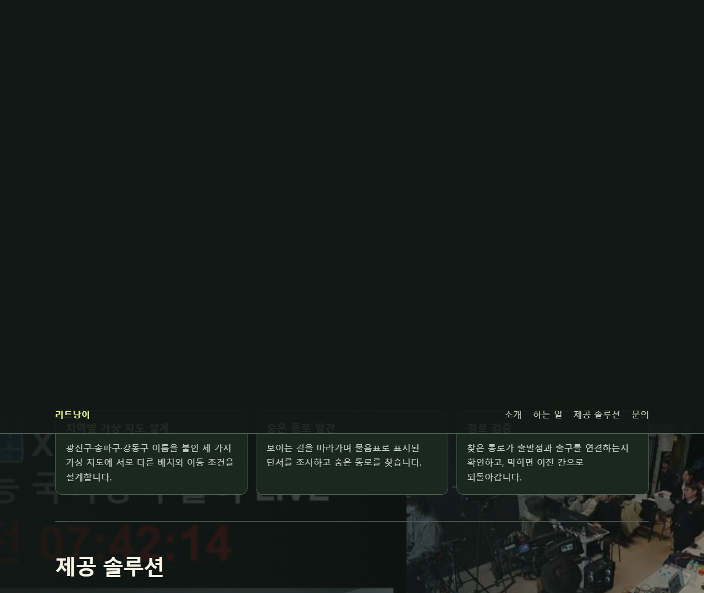

# 리트냥이

## 한 줄 소개

도주경로 찾기. 가상 지도에서 길을 탐색하는 퍼즐 팀의 실습용 홈페이지다.

## 누구를 위해 만들었나요

팀의 활동을 살펴보고 가상 지도 퍼즐을 직접 풀어 보려는 방문자를 위해 만들었다.

## 페이지 구성

- 소개와 고양이 로고
- 대표 업무 카드 세 장
- 광진구·송파구·강동구 이름을 붙인 가상 실습 지도를 제공하는 경로 분석기
- 리트냥이 지도 탐색팀 담당자와 예시 이메일

## 배포 주소

https://leetcat-theta.vercel.app

## 화면

## 만들면서 배운 점

같은 로고를 활용하면서 화면 폭에 따라 카드와 메뉴를 다르게 배치했다.
