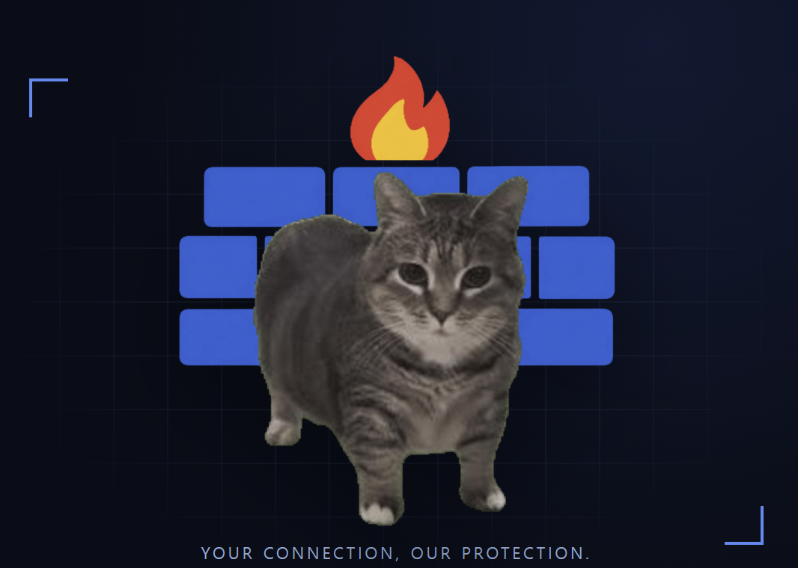

# 네트워크 보안팀

<!-- 맨 위 "팀 홈페이지 이름"을 우리 (가상) 팀 이름으로 바꿔 주세요. 예) # 디지털혁신 3팀
     ## 으로 시작하는 제목 줄은 바꾸지 마세요. 대시보드가 제목으로 내용을 찾아요. -->

## 한 줄 소개

방화벽·VPN·WAF·DDoS·WIPS·DNS·NAC 업무와 요청 방법을 소개하는 가상의 네트워크 보안팀 홈페이지.

## 누구를 위해 만들었나요

협업 부서와 신규 입사자가 팀의 역할을 이해하고, 업무 요청 방법과 준비물을 확인할 수 있도록 만들었어요.

## 페이지 구성

- 팀 소개: 고양이 방화벽 로고와 한 줄 소개
- 하는 일: 보안 업무 7개의 설명·요청 예시·준비물
- 요청 방법: 업무 선택·내용 정리·공식 절차 확인
- 자주 묻는 질문: 기본 업무와 요청 안내
- 우리가 만든 도구: 준비 중 카드
- 문의: 예시 이메일 안내

## 배포 주소

<!-- 꼭 · 버셀에서 받은 주소. 예) https://team-page-kim.vercel.app  대시보드 카드에 「사이트 열기」 버튼이 생겨요. -->
https://team-page-gamma-olive.vercel.app/

## 화면

<!-- 선택 · screenshot.png 를 넣었다면 그대로, 없으면 이 줄을 지워 주세요. -->

## 만들면서 배운 점

원하는 로고 느낌을 구체적으로 설명하니 원하는 결과가 나왔어요.
