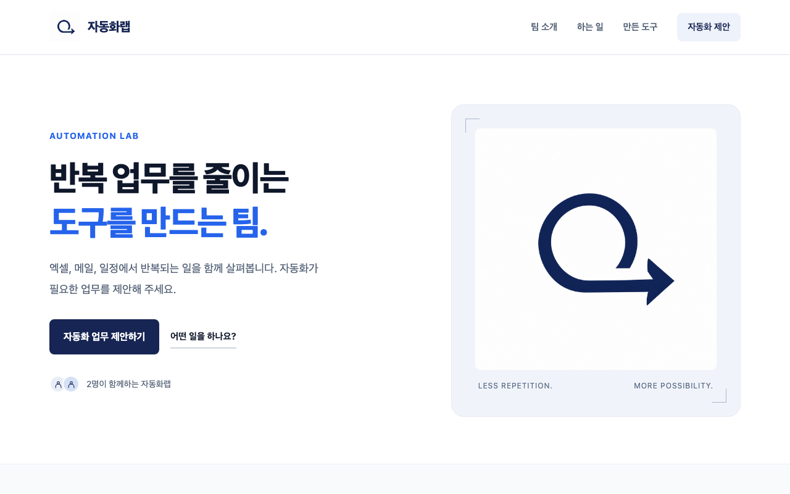

# 자동화랩

## 한 줄 소개
반복 업무를 줄이는 도구를 만드는 2명 팀

## 누구를 위해 만들었나요
협업하는 다른 팀이 자동화랩의 업무를 이해하고 자동화가 필요한 업무를 제안하도록 만들었습니다.

## 페이지 구성
- 팀 소개
- 하는 일: 엑셀 데이터 정리, 메일 정리, 일정 정리 및 알림
- 만든 도구: 준비 중
- 자동화 제안: 제안 양식 복사

## 배포 주소
https://automation-lab-sepia.vercel.app/

## 화면

## 만들면서 배운 점
vercel 배포 방법을 배웠어요.
