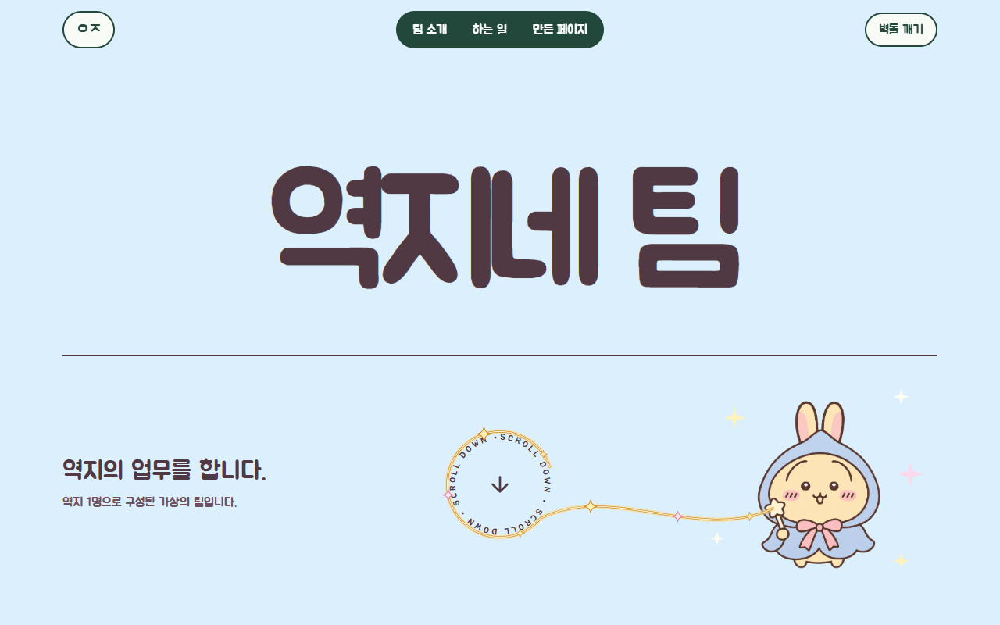

# 역지네 팀

## 한 줄 소개

역지 한 명이 데이터와 할 일을 정리하고, 만든 페이지를 소개하는 가상의 팀입니다.

## 누구를 위해 만들었나요

역지가 무슨 일을 하는지 궁금한 동료를 위해 만들었습니다. 팀의 업무를 한눈에 보고, 직접 만든 벽돌 깨기 게임을 체험할 수 있습니다.

## 페이지 구성

- 팀 소개와 생일 요정 우사기 일러스트
- 반짝이가 감싸는 스크롤 표시와 움직이는 문구
- 데이터 정리, 오늘의 할 일 정하기, 내일로 미룰 일 정하기와 항목별 상세 목록
- 만든 페이지와 벽돌 깨기 게임 링크

## 배포 주소

https://yeokjitp.vercel.app

## 화면

## 만들면서 배운 점

화면 크기가 바뀔 때 지팡이와 스크롤 표시의 위치를 다시 계산하도록 SVG 경로를 만들었습니다. 데스크톱과 휴대폰에서 별빛이 두 지점에 자연스럽게 이어지는지 확인했습니다.
