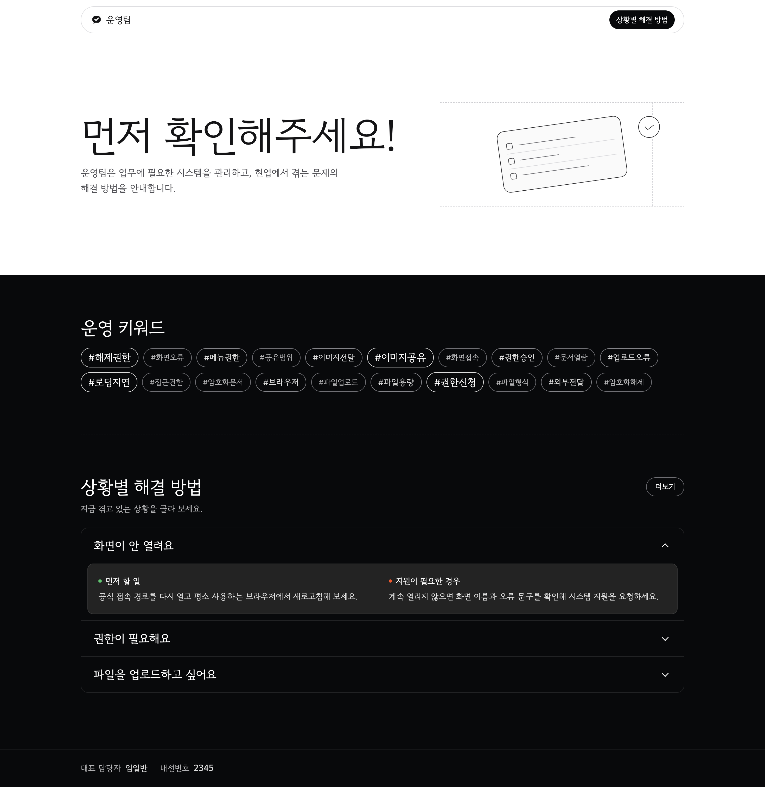

# 운영팀

## 한 줄 소개

업무 시스템에서 막혔을 때 먼저 확인할 일과 지원이 필요한 경우를 안내하는 팀 홈페이지입니다.

## 누구를 위해 만들었나요

업무 시스템을 쓰는 현업 직원이 필요한 안내를 찾아 스스로 할 수 있는 조치를 확인하도록 만들었습니다.

## 페이지 구성

- 팀 소개와 상황별 해결 방법 바로가기
- 새로고침 시 순서가 달라지는 운영 키워드 20개
- 상황별 해결 방법과 전체 목록
- 푸터의 실습용 대표 담당자와 내선번호

## 배포 주소

https://test-two-theta-61.vercel.app/

## 화면

## 만들면서 배운 점

해시태그를 안내 항목에 연결하고, 첫 화면에서 보여 줄 항목과 전체 목록을 나누는 방식을 실습했습니다.
