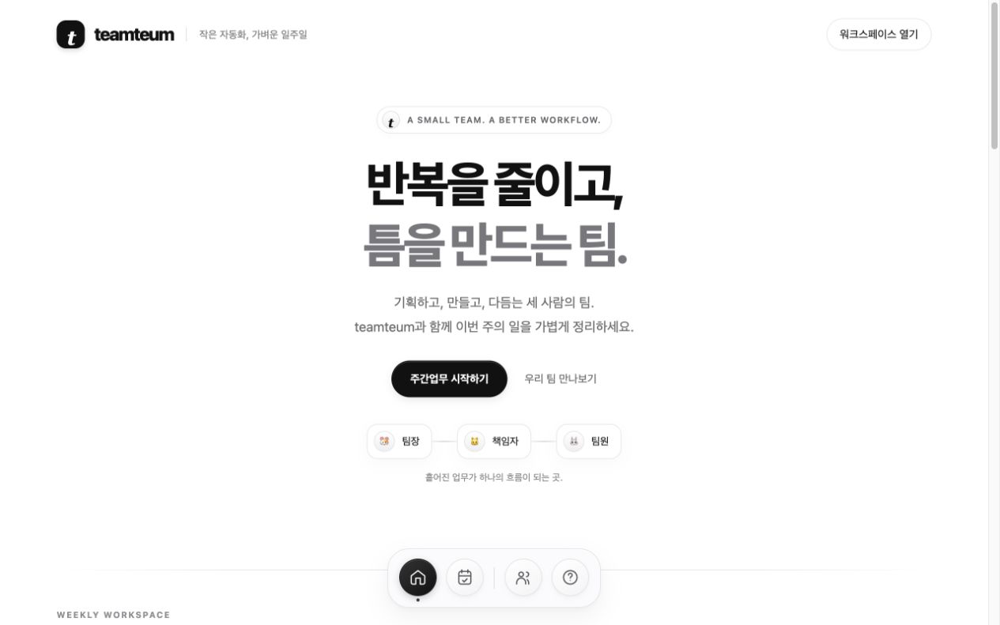

# teamteum

## 한 줄 소개

반복을 줄이고, 틈을 만드는 팀. 팀 소개와 금주·차주 주간보고 작성을 한곳에 모은 홈페이지입니다.

## 누구를 위해 만들었나요

팀원들이 업무 현황을 확인하고, 반복해서 작성하던 주간보고를 쉽게 정리할 수 있도록 만들었습니다.

## 페이지 구성

- 팀 소개: teamteum 소개와 팀장·책임자·팀원 역할 표시
- 주간업무 작성: 프로젝트 목록 불러오기, 수기 업무 추가, 업무별 보기
- 팀 주간보고: 금주·차주 표, 완료여부·기한 수정, 저장·복사·삭제
- 멤버 소개: 햄스터(팀장), 냥이(책임자), 토끼(팀원)
- 이용 안내: 보고서 작성 방법과 자주 묻는 질문

## 배포 주소

https://teamteum.vercel.app/

## 화면

## 만들면서 배운 점

페이지 구성 기획
