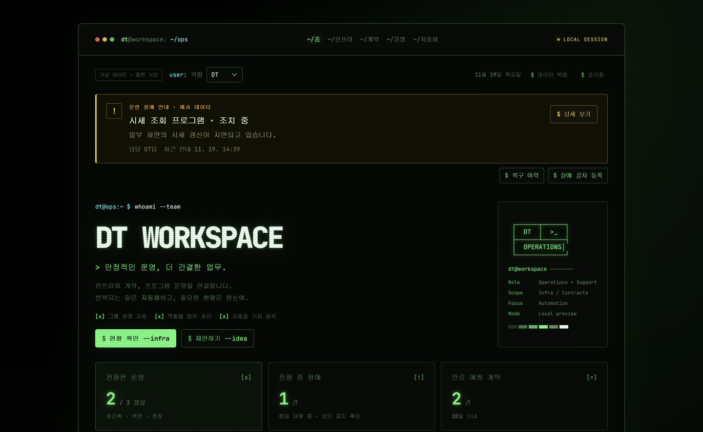

# DT Workspace · DT팀 업무 포털

## 한 줄 소개

그룹의 전광판 현황, 계약 관리, 프로그램 장애 공지와 자동화 제안을 한곳에서 확인하는 CRT 터미널 스타일의 업무 포털 시안입니다.

## 누구를 위해 만들었나요

그룹 내 직원, 관리자, DT 담당자가 각 역할에 맞는 운영 정보를 빠르게 확인하도록 만들었습니다. 모든 데이터는 가상 예시이며 역할 전환은 화면 검토용입니다.

## 페이지 구성

- 직원 / 관리자 / DT 역할 선택 및 최상단 장애 공지
- 운영 현황 요약
- 전광판 통합 현황: 계단측 / 벽면 / 천장, 새 탭에서 열리는 예시 컨트롤러 버튼
- 계약 관리: 단말기 / 데이터 / 프로그램 라이선스, 업체·기간·만료일·경비/자본 구분
- 프로그램 운영: 준비 중
- 자동화 제안 등록

## 배포 주소

https://dtteampage.vercel.app/

## 화면

index.html을 내려받아 브라우저에서 열면 확인할 수 있습니다. 별도 설치나 빌드가 필요하지 않습니다.

## 만들면서 배운 점

작성자 별도 기재 전입니다.

## 제출 파일

- index.html: CSS·JavaScript를 포함한 최신 홈페이지 소스
- prd.md: 기획서
- build-plan.md: 제작 계획서
- logo-prompt.md: 초기 기획에서 작성한 로고 프롬프트
- vercel.json: 개별 저장소에서 사용할 정적 사이트 배포 설정
- index-before-crt.html: 이전 초록·흰색 디자인
- preview-crt.png / preview.png: 첫 화면 및 전체 화면 미리보기
- screenshot.png: 수업 제출용 대표 화면
- USAGE.md: 원본 폴더의 README 사용 안내
- .gitignore / images/: 원본 설정과 이미지 폴더

변경한 데이터는 현재 브라우저에 저장됩니다. 실제 계정 로그인과 서버 권한 검사는 연결하지 않았습니다. 컨트롤러 버튼의 주소는 https://example.com/ 예시입니다.
