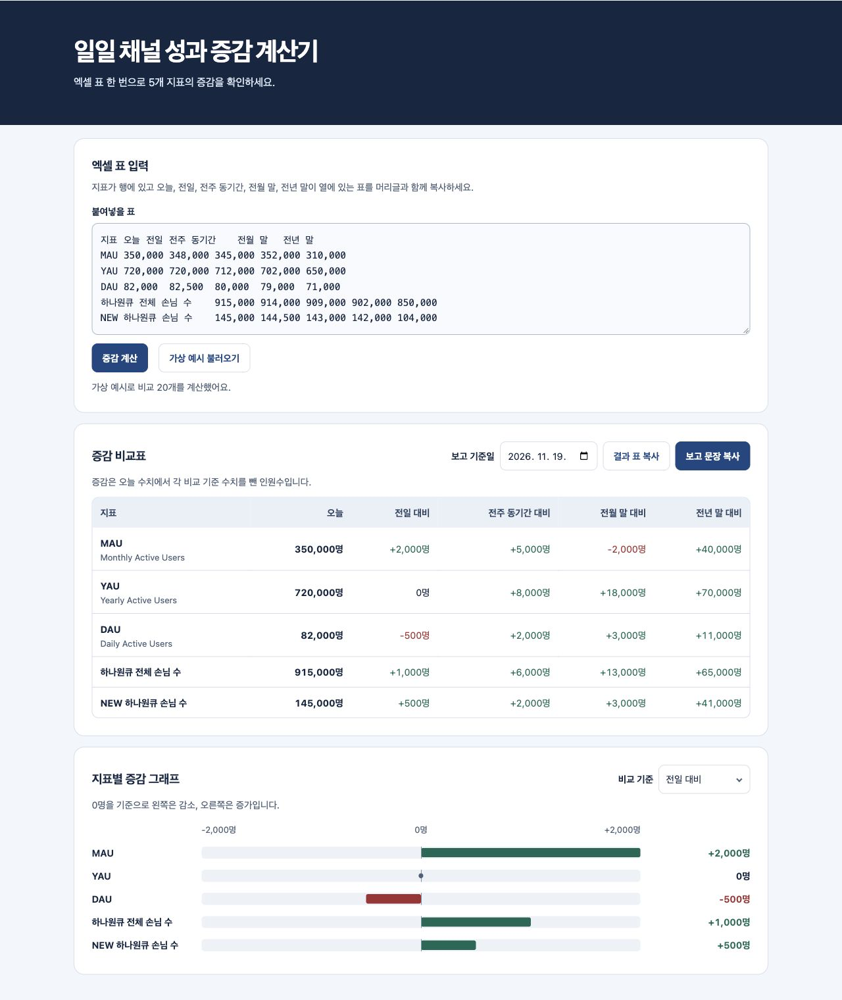

# 일일 채널 성과 증감 계산기

## 한 줄 소개

엑셀 표를 붙여넣으면 채널 이용 지표 5개의 증감을 계산하고, 일일 보고 문장으로 복사할 수 있는 도구입니다.

## 어떤 불편을 줄이나요

매일 지표별로 네 가지 기준과 비교한 뒤, 결과를 보고 자료에 옮겨 적는 일을 줄입니다.

## 꼭 필요한 기능

- 엑셀 표에서 5개 지표의 전일·전주 동기간·전월 말·전년 말 대비 증감 20개를 계산합니다.
- 결과를 그래프로 볼 수 있고, 비교 기준을 바꿀 수 있습니다.
- 결과 표 또는 보고 기준일이 포함된 지표별 문장을 복사할 수 있습니다.

## 아낄 수 있는 시간

일일 보고에 적용한 뒤 측정할 예정입니다.

## 써 보는 법

- 브라우저에서 `index.html`을 열면 실습용 가상 예시가 표시됩니다.
- 같은 형식의 엑셀 표를 머리글과 함께 붙여넣고 「증감 계산」을 누릅니다.
- 보고 기준일을 선택하고 「보고 문장 복사」를 누릅니다.

## 배포 주소

https://hanaoneqdaily.vercel.app

배포 주소를 열려면 Vercel 로그인과 프로젝트 접근 권한이 필요합니다. 실습은 이 폴더의 `index.html`을 브라우저에서 열어서도 할 수 있습니다.

## 화면

## 다음에 붙이고 싶은 기능

- 실제 사용 후 필요한 기능을 정할 예정입니다.
