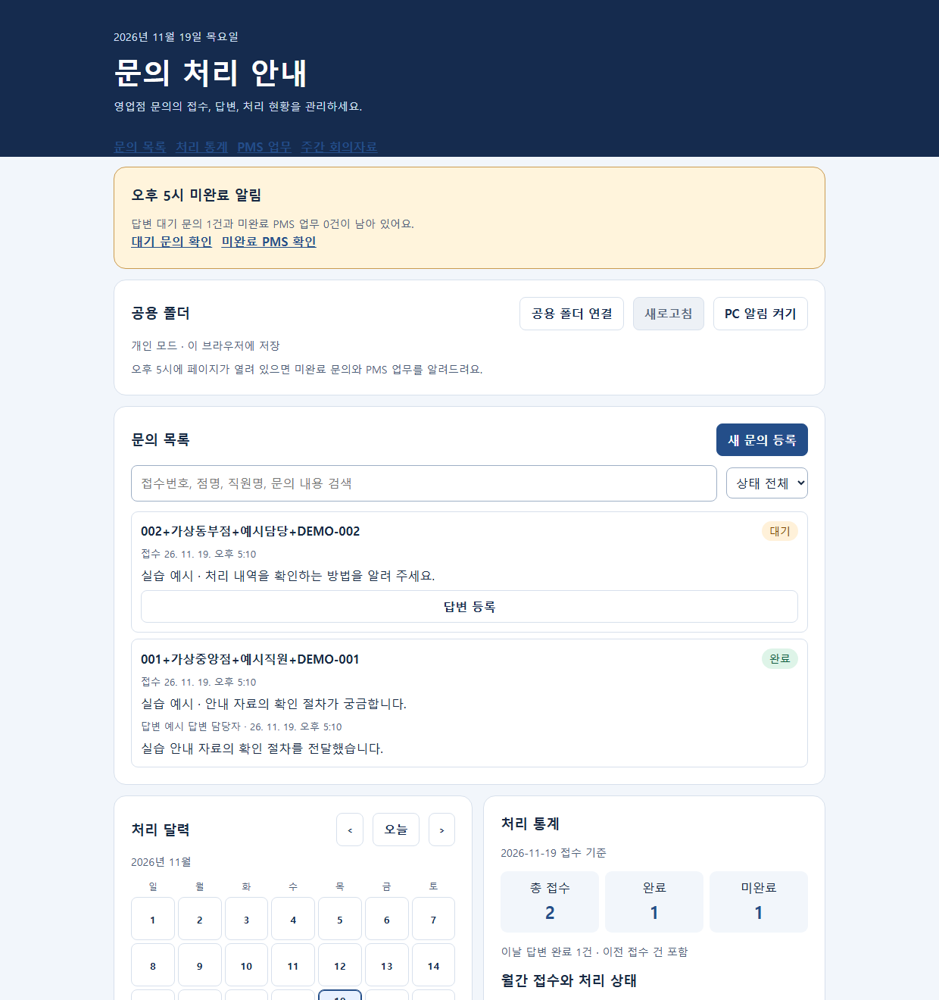

# 문의 처리 안내 업무 OS

<!-- 맨 위 "도구 이름"을 내 도구 이름으로 바꿔 주세요. 예) # 예적금 만기 계산기
     ## 으로 시작하는 제목 줄은 바꾸지 마세요. 대시보드가 제목으로 내용을 찾아요. -->

## 한 줄 소개

영업점 문의의 접수와 답변, 직원별 PMS 업무, 일별 처리 현황을 한 화면에서 관리하는 도구입니다.

## 어떤 불편을 줄이나요

문의가 들어올 때마다 엑셀에서 처리 상태를 찾고, 비슷한 답장과 안내 문구를 다시 쓰는 일을 줄입니다.

## 꼭 필요한 기능

- `점번호+점명+직원명+직원번호`로 문의를 찾고, 답변을 저장하면 대기 상태를 완료로 바꿉니다.
- 달력과 월간 통계에서 접수·완료·미완료 건수를 확인합니다.
- 직원별 PMS를 중요도순으로 정리해 주간 회의자료를 만들고, 오후 5시에 미완료 건을 확인합니다.

## 아낄 수 있는 시간

현재 문의 확인과 안내에 하루 약 30분이 걸립니다. 절감 시간은 사용 후 측정할 예정입니다.

## 써 보는 법

- PC용 Chrome 또는 Edge에서 `index.html`을 열고, 가짜 점번호와 직원 정보로 문의를 등록해 보세요.
- 문의를 검색하고 가짜 답변을 저장한 뒤, 달력과 통계의 건수가 바뀌는지 확인하세요.
- PMS 업무를 예시 값으로 등록하고, 중요도를 선택해 회의자료를 만들어 보세요.

## 배포 주소

https://lucygwon-work-os.vercel.app/

## 화면

<!-- screenshot.png 는 꼭 · 가짜 데이터를 넣은 화면 -->

## 다음에 붙이고 싶은 기능

- 실제 공용 폴더에서 팀 계정 두 개로 공유 동작과 알림을 점검합니다.
