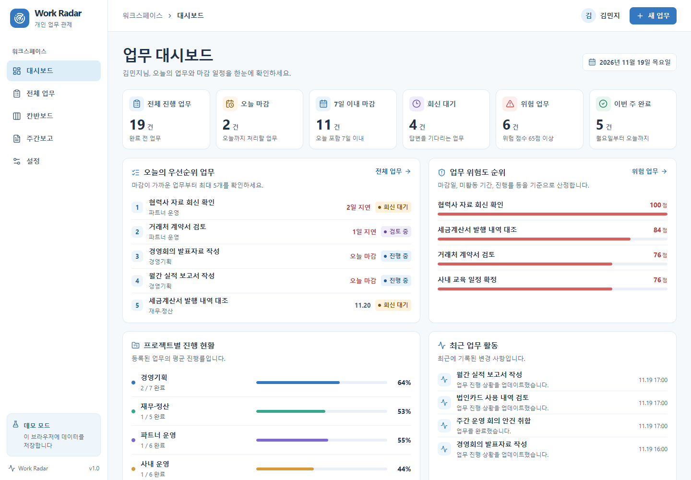

# Work Radar · 개인 업무 관제

## 한 줄 소개

업무의 마감 위험과 진행 상황을 한눈에 보고, 업무 기록으로 주간보고를 만드는 개인 업무 도구입니다.

## 어떤 불편을 줄이나요

흩어진 업무 목록에서 오늘 처리할 업무, 밀린 회신, 이번 주 완료 내역을 찾아 주간보고에 옮겨 적는 일을 줄입니다.

## 꼭 필요한 기능

- 대시보드에서 오늘 마감과 위험 업무를 확인하고 관련 업무를 엽니다.
- 전체 업무 목록과 칸반에서 등록, 상태 변경, 마감 관리, 활동 기록을 처리합니다.
- 기간과 프로젝트를 선택해 주간보고를 생성하고 편집하거나 TXT로 내려받습니다.

## 아낄 수 있는 시간

실제 절약 시간은 아직 측정하지 않았습니다.

## 써 보는 법

- 이 폴더의 `index.html`을 내려받아 Chrome 또는 Edge에서 엽니다. 첫 실행에는 가상의 사무 업무 24개가 표시됩니다.
- 대시보드의 **위험 업무**를 열어 마감과 다음 행동을 확인합니다. **새 업무**로 가상 업무를 하나 추가한 다음 칸반에서 상태를 바꿔 봅니다.
- **주간보고**에서 기간과 프로젝트를 선택하고, 미리보기를 확인한 뒤 TXT로 내려받습니다.
- 데이터는 파일을 연 브라우저에 저장됩니다. 연습에는 가상 데이터만 사용하세요.

## 배포 주소

## 화면

## 다음에 붙이고 싶은 기능

- 계정별 접근 제어와 기기 간 동기화
- 날짜별 업무 변경 이력을 활용한 과거 주간보고 재구성
