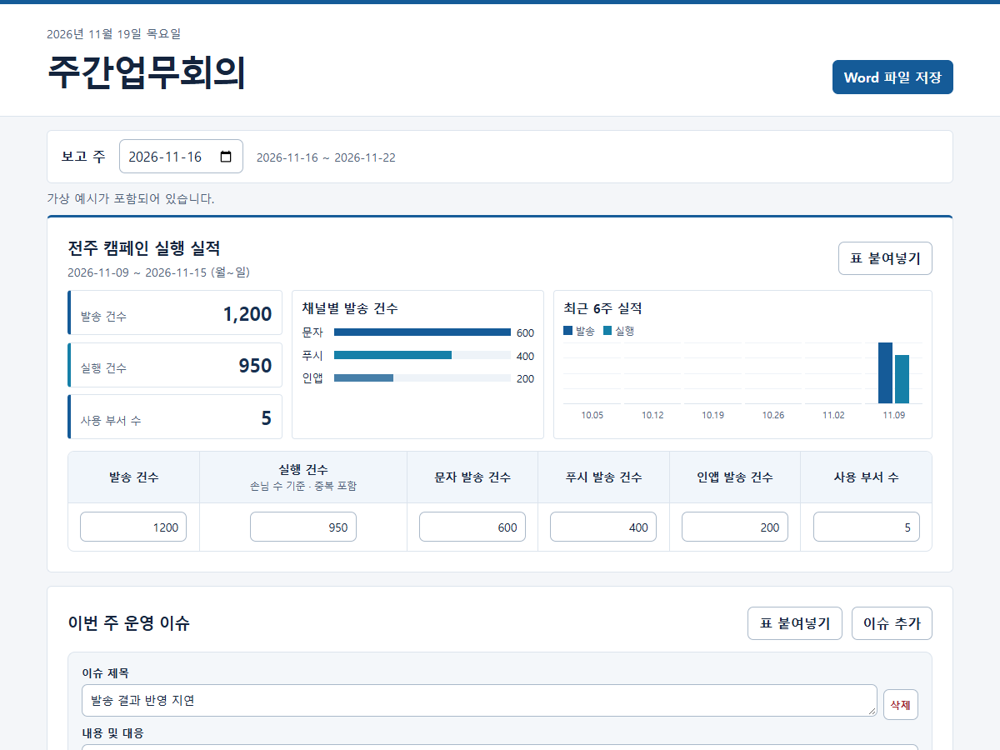

# 주간업무회의 대시보드

<!-- 맨 위 "도구 이름"을 내 도구 이름으로 바꿔 주세요. 예) # 예적금 만기 계산기
     ## 으로 시작하는 제목 줄은 바꾸지 마세요. 대시보드가 제목으로 내용을 찾아요. -->

## 한 줄 소개

<!-- 무엇을 하는 도구인지 한 문장으로. 예) 원금·금리·기간을 넣으면 세후 수령액을 바로 보여 주는 계산기 -->
전주 캠페인 실적과 이번 주 운영 이슈·추진 업무를 정리해 Word 회의자료를 만드는 도구입니다.

## 어떤 불편을 줄이나요

<!-- 매일·매주 무엇이 귀찮았는지. 예) 고객이 만기 금액을 물을 때마다 계산기를 두드렸어요 -->
팀원이 작성한 업무 내용과 이미 집계된 캠페인 숫자를 매주 회의자료에 옮기는 작업을 줄입니다.

## 꼭 필요한 기능

<!-- 3개 이하. 한 줄에 하나씩, 맨 앞에 - -->
- 전주 월~일 캠페인 실적을 가로표에 입력하고 지표 카드와 차트로 확인합니다.
- 운영 이슈와 단위 업무별 현황·개선 전·개선 후를 기록합니다.
- 선택한 보고 주의 자료를 편집 가능한 Word 파일로 저장합니다.

## 아낄 수 있는 시간

<!-- 이 도구로 매주 얼마나 시간을 아낄 것 같은지. 예) 매주 1시간 -->
기존에는 매주 약 30분이 걸렸습니다. 절감 시간은 실제 사용 후 비교할 예정입니다.

## 써 보는 법

<!-- index.html 을 열고 무엇을 넣어 보면 되는지. 한 줄에 하나씩 - -->
- 배포 주소로 접속하거나 index.html을 더블클릭합니다.
- 보고 주를 선택하고 가상 캠페인 집계 수치와 운영 이슈·추진 업무를 입력합니다.
- **Word 파일 저장**을 눌러 회의자료를 내려받습니다.

## 배포 주소

<!-- 선택 · 버셀 주소가 있으면. 예) https://team-page-kim.vercel.app/tools/deposit-calc/  없으면 이 칸은 비워 둬요. -->
https://weekly-work-dashboard-taupe.vercel.app/

## 화면

<!-- screenshot.png 는 꼭 · 가짜 데이터를 넣은 화면 -->

## 다음에 붙이고 싶은 기능

<!-- "있으면 좋음"에 남겨 둔 것. 한 줄에 하나씩 - -->
- 기존 Word 회의자료 양식에 맞춘 표와 문단 서식
