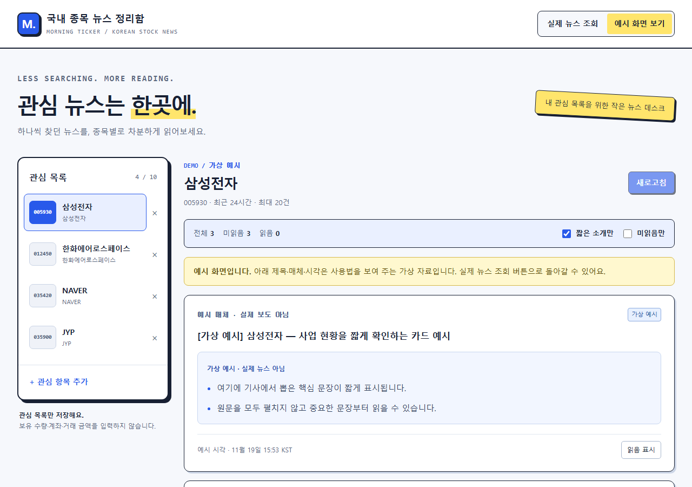

# 국내 종목 뉴스 정리함

<!-- 맨 위 "도구 이름"을 내 도구 이름으로 바꿔 주세요. 예) # 예적금 만기 계산기
     ## 으로 시작하는 제목 줄은 바꾸지 마세요. 대시보드가 제목으로 내용을 찾아요. -->

## 한 줄 소개

관심 국내 종목의 한국어 뉴스를 모아 핵심 문장과 매체가 제공한 짧은 소개부터 보여 주는 뉴스 도구.

## 어떤 불편을 줄이나요

여러 관심 종목의 뉴스를 사이트마다 따로 검색하고, 읽은 기사를 다시 확인하는 일을 줄입니다.

## 꼭 필요한 기능

- 관심 목록 등록·삭제·되돌리기
- 국내 종목의 한국어 기사 수집과 짧은 소개 표시
- 읽음 표시·미읽음 필터·브라우저 기록 저장

## 아낄 수 있는 시간

아직 측정하지 않았습니다.

## 써 보는 법

- 서버를 실행하고 http://127.0.0.1:4184/ 를 엽니다. 이 도구는 사용자 요청에 따라 서버 크롤링 방식으로 확장했습니다.
- 기본 관심 목록은 삼성전자·한화에어로스페이스·NAVER·JYP입니다. 항목을 선택하면 최근 24시간 한국어 기사 최대 20개를 모읍니다.
- ‘짧은 소개만’이 기본으로 켜져 있어 핵심 문장 발췌·매체 소개부터 읽을 수 있습니다. 끄면 제목·링크만 있는 기사도 표시합니다.
- 현재의 짧은 소개는 원문 문장 발췌 또는 매체 소개입니다. AI가 새로 작성한 요약은 아닙니다.
- 읽은 기사는 ‘읽음 표시’를 누릅니다. ‘예시 화면 보기’는 가상 자료로 구분됩니다.

### 로컬 실행

이 폴더에서 `pnpm install --ignore-scripts` 후 `pnpm start`를 실행합니다. 실제 기사 수집에는 서버가 필요합니다.

### 배포할 때

`index.html`만 올리면 기사 수집이 동작하지 않습니다. `api/news.js`, `lib/crawler.mjs`, `package.json`, `pnpm-lock.yaml`, `vercel.json`을 함께 배포해야 합니다. 이 폴더 자체를 별도 Vercel 프로젝트의 루트로 사용하거나, 팀 페이지에 붙일 때는 API·의존성 파일을 개인 team-page 저장소 루트에 두고 도구 화면을 tools/ 아래에 둡니다. 수업 저장소 전체를 Vercel에 연결하지 않습니다.

## 배포 주소

<!-- 선택 · 버셀 주소가 있으면. 예) https://team-page-kim.vercel.app/tools/deposit-calc/  없으면 이 칸은 비워 둬요. -->

## 화면

## 다음에 붙이고 싶은 기능

- AI가 새로 쓰는 문맥 요약
- 아침 예약 수집·알림
- 관심 목록 백업·복원
