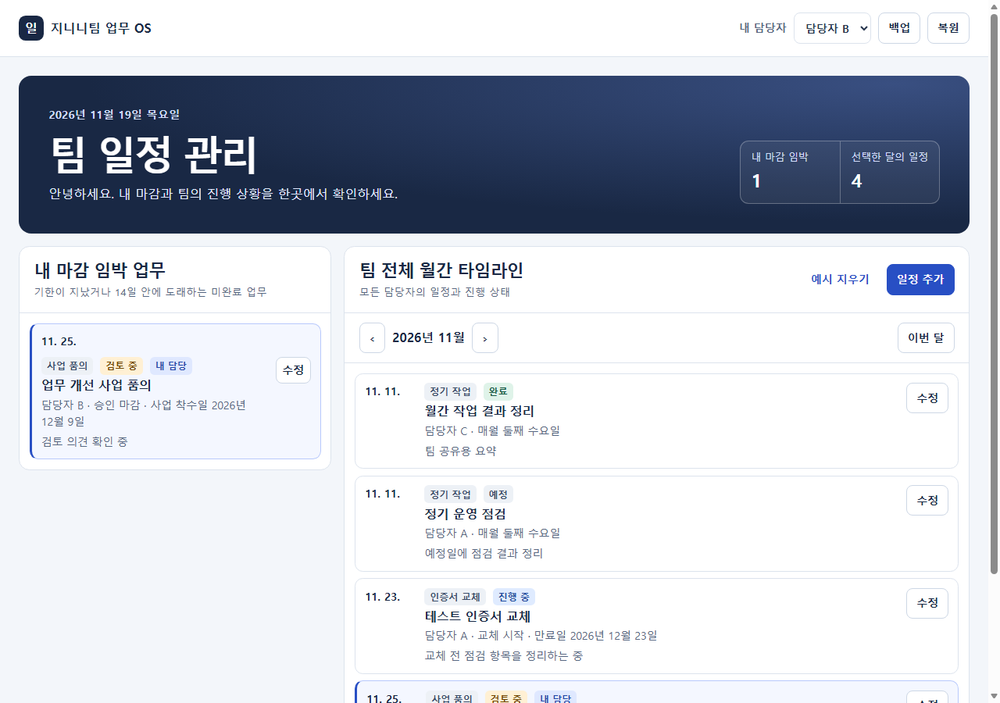

# 지니니팀 업무 OS

## 한 줄 소개

인증서 교체, 사업 품의, 정기 작업의 마감과 진행 상태를 한 화면에서 보는 팀 일정 대시보드입니다.

## 어떤 불편을 줄이나요

메일에 흩어진 일정과 상태를 찾기 위해 지난 메일을 다시 읽거나 담당자에게 최신 정보를 물어보는 일을 줄입니다.

## 꼭 필요한 기능

- 내 담당자를 골라 임박 업무를 모아 보고, 팀 타임라인에서 내 일정을 강조합니다.
- 인증서 교체 시작일, 사업 품의 승인 마감일, 월별 정기 작업일을 자동으로 계산합니다.
- 일정과 상태를 브라우저에 저장하고, JSON 파일로 백업하거나 복원합니다.

## 아낄 수 있는 시간

실제 업무에 적용한 뒤 일정 확인에 걸리는 시간을 비교해 측정할 예정입니다.

## 써 보는 법

- 배포 주소나 `index.html`을 열고 ‘내 담당자’를 바꿔 강조 표시를 확인합니다.
- ‘일정 추가’에서 가상의 업무와 기준일을 입력합니다. 타임라인에서는 월을 이동하거나 ‘수정’으로 상태를 바꿀 수 있습니다.
- 상단의 ‘백업’과 ‘복원’으로 현재 브라우저의 예시 일정을 옮길 수 있습니다.

## 배포 주소

https://s3-lac.vercel.app/

## 화면

## 다음에 붙이고 싶은 기능

- 팀원이 여러 기기에서 같은 일정을 볼 수 있도록 공유 저장소와 접근 권한을 연결합니다.
