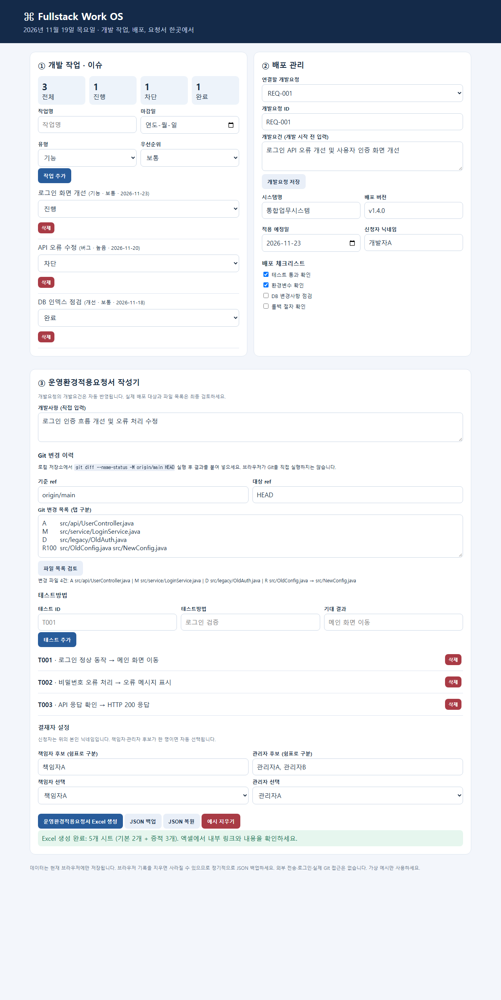

# 풀스택 개발자 업무 OS

## 한 줄 소개

개발 작업과 배포를 관리하고 운영환경적용요청서 Excel 초안을 만드는 브라우저 도구입니다.

## 어떤 불편을 줄이나요

개발요청의 요건을 다시 옮겨 적고, Git 변경 파일을 정리하고, 테스트마다 증적 시트를 복사하는 반복 작업을 줄입니다.

## 꼭 필요한 기능

- 개발 작업의 상태와 우선순위를 관리합니다.
- 배포 건에 개발요청을 연결하고 배포 체크리스트를 확인합니다.
- 붙여 넣은 Git 변경 목록과 테스트 항목으로 운영환경적용요청서와 증적 시트를 생성합니다.

## 아낄 수 있는 시간

실측 전입니다.

## 써 보는 법

- `index.html`을 브라우저에서 열면 가상 개발 작업과 배포 예시가 표시됩니다.
- 「파일 목록 검토」를 누르면 가상 Git 변경 목록이 분류됩니다.
- 관리자 후보에서 「관리자A」를 선택하고 「운영환경적용요청서 Excel 생성」을 누릅니다. 기본 2개와 테스트 증적 3개를 포함한 예시 파일이 내려받아집니다.

## 배포 주소

## 화면

## 다음에 붙이고 싶은 기능

- 테스트 증적 이미지를 문서 생성 단계에서 첨부하기
