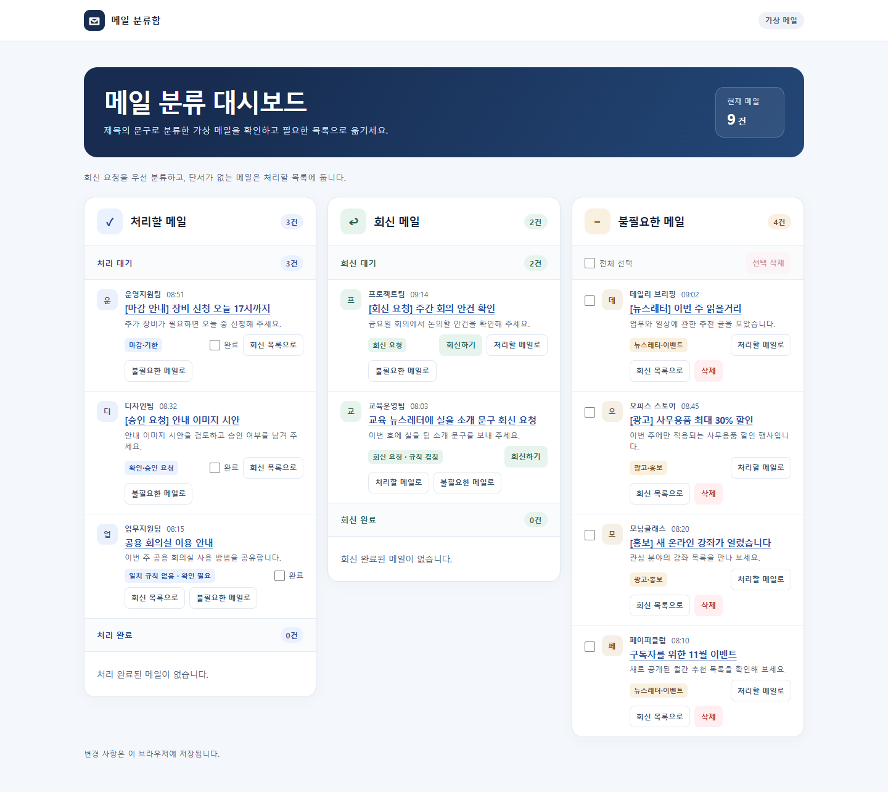

# 가상 메일 분류 대시보드

## 한 줄 소개

가상 메일의 제목을 기준으로 세 목록에 분류하고, 처리와 회신 상태를 한 화면에서 관리합니다.

## 어떤 불편을 줄이나요

받는 메일이 많을 때 처리해야 할 일, 답장할 일, 지워도 되는 메일을 매번 골라내는 수고를 줄입니다.

## 꼭 필요한 기능

- 가상 메일을 자동 분류하고 필요한 경우 다른 목록으로 직접 옮깁니다.
- 처리 완료를 체크하거나 해제해 대기와 완료 목록 사이를 이동합니다. 원문을 보며 가상 답장을 작성하고 저장하면 회신 완료에서 다시 볼 수 있습니다.
- 불필요한 메일을 한 건씩 또는 여러 건 삭제하고 최근 삭제를 되돌립니다.

## 아낄 수 있는 시간

가상 메일로 기능을 확인했으며 실제 절약 시간은 아직 측정하지 않았습니다.

## 써 보는 법

- [index.html](index.html)을 브라우저에서 열고 자동 분류된 가상 메일 9건을 확인합니다.
- 제목을 눌러 본문을 읽고, 처리 완료 체크나 `회신하기` 버튼을 사용해 봅니다.
- 불필요한 메일을 삭제한 뒤 `삭제 되돌리기`로 복구해 봅니다.

## 배포 주소

## 화면

## 다음에 붙이고 싶은 기능

- 메일 제목과 보낸 사람으로 검색합니다.
