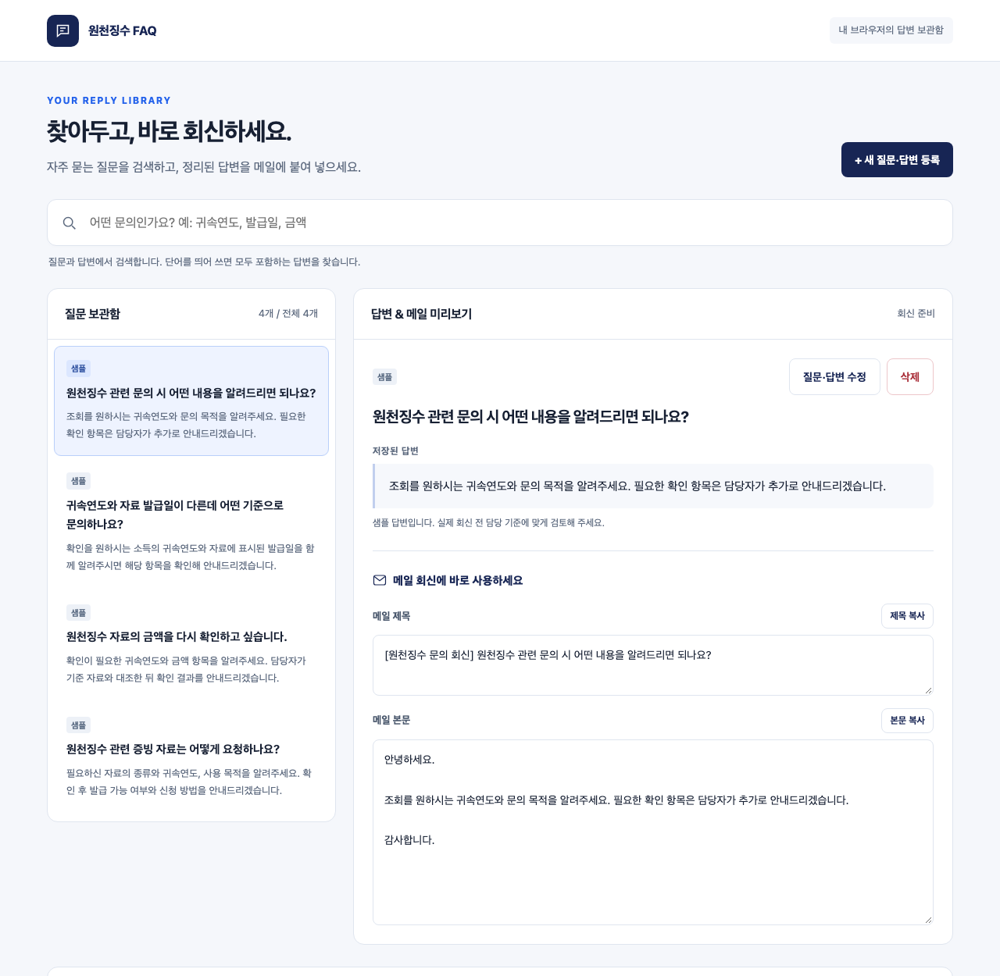

# 원천징수 FAQ 답변 도구

## 한 줄 소개
자주 받는 원천징수 질문과 답변을 검색하고 메일 회신 내용을 만드는 도구

## 어떤 불편을 줄이나요
반복 문의가 올 때마다 과거 메일에서 답변을 찾아 다시 작성하는 일을 줄입니다.

## 꼭 필요한 기능
- 질문·답변 키워드 검색
- 메일 제목·본문 생성 및 복사
- FAQ 등록·수정·삭제와 관련 질문 카드 비교

## 아낄 수 있는 시간
매주 30분

## 써 보는 법
- index.html을 열거나 아래 배포 주소에 접속합니다.
- ‘발급일’을 검색하고 질문을 선택해 메일 본문을 복사합니다.
- 새 질문·답변을 등록하면 같은 브라우저에서 다시 찾을 수 있습니다.
- 관련 질문 카드가 나타나면 동일한 문의는 기존 답변을 사용하고, 다른 문의만 등록합니다.

## 배포 주소
https://wonchon-guide.vercel.app/

## 화면

## 다음에 붙이고 싶은 기능
- 질문·답변 JSON 백업·복원
- 태그 분류와 즐겨찾기
