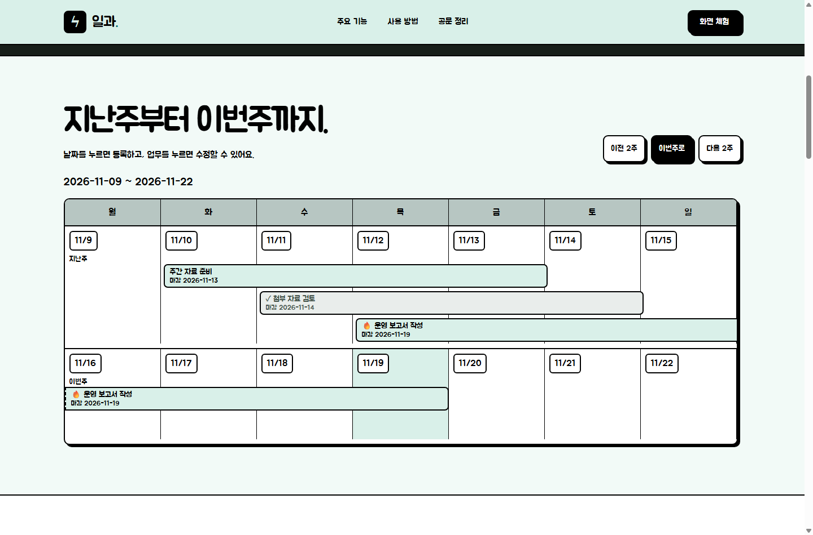

# 일과 · 나만의 업무 비서

## 한 줄 소개

지난주와 이번주 업무를 캘린더에서 보고, 기간 업무와 긴급 업무를 관리하며 공문 이미지의 내용을 정리하는 개인용 업무 비서 시안입니다.

## 어떤 불편을 줄이나요

종이 스케줄러에 매일·매주 반복 업무를 다시 적는 것이 번거롭고, 새로운 업무가 들어오거나 마감일이 바뀔 때마다 지우고 고쳐 쓰기가 불편했습니다. 업무를 한 번 등록하고 기간과 마감을 바로 수정하며, 지난 기록도 찾아볼 수 있게 만들었습니다.

## 꼭 필요한 기능

- 업무 추가·수정·삭제·완료와 🔥 긴급 업무 목록
- 지난주·이번주 캘린더와 시작일부터 마감일까지 이어지는 기간 업무 막대
- 공문 이미지 글자 추출과 해야 할 업무·준비물·마감·제출 방법 정리

## 아낄 수 있는 시간

실사용 후 측정 예정입니다.

## 써 보는 법

- 배포 주소 또는 이 폴더의 `index.html`을 엽니다.
- 캘린더 날짜를 누르고 ‘주간 자료 준비’ 같은 가짜 업무와 시작일·마감일을 넣어 등록합니다.
- 기간 업무가 여러 날짜에 걸쳐 하나의 막대로 표시되는지 확인하고, 막대를 눌러 기간을 수정합니다.
- 긴급을 체크하면 🔥 표시와 긴급 목록에서 함께 확인할 수 있습니다.
- 가상 공문 이미지를 선택해 글자를 추출하고 원문을 확인한 뒤 업무를 정리합니다. 첫 OCR 실행에는 인터넷 연결이 필요합니다.
- 등록한 업무는 해당 브라우저에 저장됩니다. 기기·주소 간 동기화는 후속 개발 항목입니다.

## 배포 주소

https://yeokjiwork.vercel.app/

개인 개발 저장소는 [geongkwon/Yeokji_work](https://github.com/geongkwon/Yeokji_work)입니다. 제출본은 실행에 필요한 스타일·스크립트·글꼴을 HTML에 포함했습니다.

## 화면

## 다음에 붙이고 싶은 기능

- 반복 업무의 날짜별 완료 이력과 오늘 할 일 필터
- JSON 백업·복원과 자주 쓰는 문구 보관함
- 입력한 문장을 같은 화면에서 자연스럽게 다시 쓰는 AI 연결
- 공문 내용을 문맥까지 이해하는 AI 분석
- 브라우저 종료 상태에서도 받는 오전 8시 40분 알림
