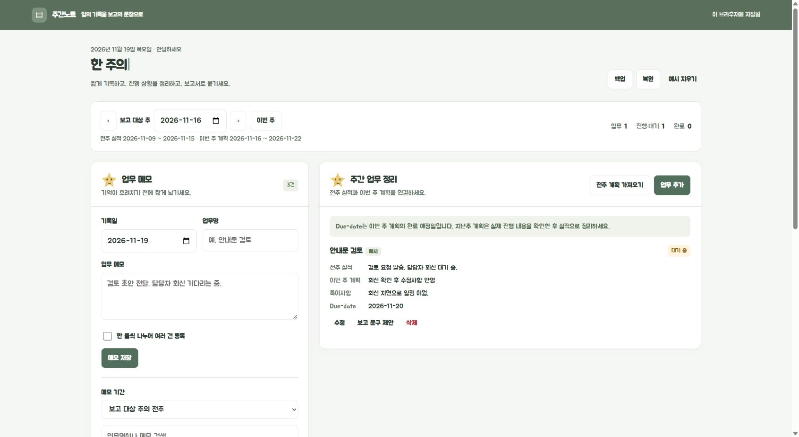

# 주간노트 · 주간업무일지 대시보드

## 한 줄 소개

평소 업무 메모를 모아 전주 실적과 이번 주 계획을 정리하고 보고서 초안으로 만드는 개인용 업무 대시보드입니다.

## 어떤 불편을 줄이나요

매주 메모장에 초안을 작성할 때 지난주에 한 일이 산발적으로 기억나고, 미뤄진 업무의 진행 상황을 설명하거나 보고용 표현으로 정리하는 데 시간이 오래 걸렸습니다.

## 꼭 필요한 기능

- 업무 메모를 개별 또는 여러 줄로 입력하고 날짜·업무명으로 찾아보기
- 전주 계획을 가져와 실제 실적, 이번 주 계획, 상태, 특이사항과 Due-date 정리하기
- 보고용 문구 제안과 직접 편집을 거쳐 5개 열의 보고서 초안을 표 또는 텍스트로 복사하기

## 아낄 수 있는 시간

아직 측정하지 않았습니다. 실제 사용 후 확인할 예정입니다.

## 써 보는 법

- 아래 배포 주소에 접속하거나 이 폴더의 index.html을 브라우저로 엽니다.
- 가상 예시를 살펴보고 업무 메모를 짧게 기록합니다. 여러 줄 일괄 입력도 가능합니다.
- 보고 대상 주를 선택하고 메모와 전주 계획을 참고해 주간 업무를 정리합니다. Due-date는 해당 주에 일을 끝낼 예정일입니다.
- 보고 문구 제안을 확인하고 보고서 초안을 만든 뒤 셀을 눌러 수정하거나 복사합니다.
- 기록은 사용한 브라우저에 저장됩니다. 주기적으로 백업 버튼을 눌러 JSON 파일로 보관합니다.

## 배포 주소

[주간노트 사용하기](https://weekly-action.vercel.app/)

## 화면

## 다음에 붙이고 싶은 기능

- 자유롭게 쓴 메모를 자연스러운 보고 문장으로 다듬는 AI 기능
- 실제 사용 시간을 기록해 주간일지 작성 시간의 변화를 확인하는 기능
