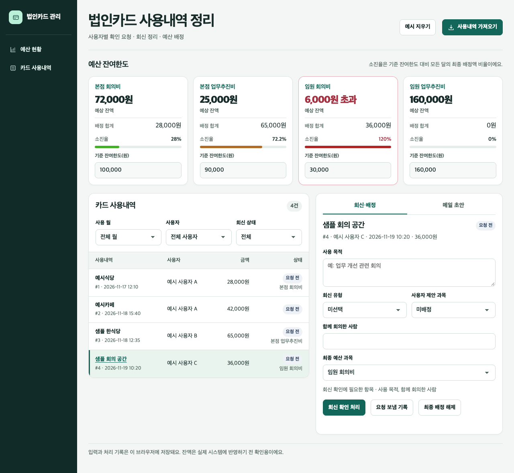

# 서무 카드 사용내역 정리

## 한 줄 소개

미배정 법인카드 사용내역에서 사용자별 회신 요청을 만들고, 회신과 예산 배정을 한 화면에서 정리하는 도구예요.

## 어떤 불편을 줄이나요

매달 카드 사용내역을 사용자별로 걸러 메일을 작성하고, 받은 회신을 결제 건에 맞춰 정리했어요. 최종 예산 과목을 고를 때는 네 과목의 잔여한도도 따로 확인해야 했어요.

## 꼭 필요한 기능

- 미배정 내역을 Excel 파일이나 표로 가져오고, 월·사용자별 회신 요청 메일의 제목과 표를 복사해요.
- 결제별로 사용 목적과 회의 참석자 또는 접대 회사·참석자를 기록하고, 최종 예산 과목을 선택해요.
- 본점과 임원의 회의비·업무추진비별로 예상 잔액과 소진율을 확인해요.

## 아낄 수 있는 시간

아직 측정 전이에요. 처리 건수에 따라 달라져요.

## 써 보는 법

- `index.html`을 Chrome에서 열고 내장 예시를 확인해요. **사용내역 가져오기 → 예시 표 넣기 → 목록에 추가**로 가상 결제도 추가할 수 있어요.
- 사용 월과 사용자를 선택한 뒤 **메일 초안**에서 제목과 회신용 표를 확인해요.
- **회신·배정**에서 28,000원 예시 결제를 본점 회의비에 배정해 보세요. 기준 잔여한도가 100,000원이면 예상 잔액은 72,000원이고 소진율은 28%예요.

## 배포 주소

## 화면

## 다음에 붙이고 싶은 기능

- 이번 실습에서 정한 기능으로 사용해 보고 불편한 점을 기록할 예정이에요.
