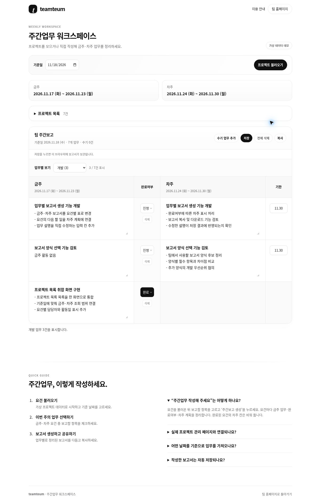

# 주간업무 워크스페이스 · teamteum

## 한 줄 소개

프로젝트 업무와 직접 입력한 업무를 금주·차주 주간보고로 정리하고, 수정·저장·복사할 수 있는 독립 웹 도구입니다.

## 어떤 불편을 줄이나요

여러 업무의 진행 상황과 다음 주 계획을 매번 모아 주간보고 표에 옮겨 적는 반복 작업을 줄입니다.

## 꼭 필요한 기능

- 가상 프로젝트 목록을 불러와 선택한 업무를 금주·차주 보고서로 취합합니다.
- 수기 업무를 추가하고, 업무별로 골라 보면서 금주·차주 내용·완료여부·기한을 수정합니다.
- 전체 보고서를 이 브라우저에 저장·복원하고, 현재 보이는 업무를 복사하거나 삭제합니다.

## 아낄 수 있는 시간

아직 측정하지 않았습니다. 업무 취합과 보고서 표 작성의 반복 작업을 줄이는 용도입니다.

## 써 보는 법

- 이 폴더의 **`index.html`을 열면 주간업무 워크스페이스가 바로 표시됩니다.**
- 기준일 `2026-11-18`에서 **프로젝트 불러오기** → 보고할 업무 선택 → **주간보고 생성**을 누르면 가상 업무로 체험할 수 있습니다.
- **수기 업무 추가**로 새 업무를 입력하거나, 보고서 표에서 금주·차주 내용과 완료여부·기한을 수정합니다.
- **업무별 보기**로 전체·기획·개발·검토·기타를 골라 보고 **복사**로 현재 보이는 업무를 가져갑니다.
- **저장**은 필터와 관계없이 전체 보고서 한 개를 현재 브라우저에 보관합니다. 자동 저장 및 기기 간 동기화는 지원하지 않습니다.
- **전체 삭제**는 확인 후 현재 보고서와 이 도구의 저장 내용을 함께 지웁니다.
- 상단과 하단의 **팀 홈페이지** 링크는 기존 온라인 홈페이지를 엽니다.

## 배포 주소

https://teamteum.vercel.app/workspace.html

## 화면

위 배포 주소에서 가상 프로젝트 7건을 불러와 보고서를 생성한 뒤, **개발 업무 3건**을 골라 본 실제 화면입니다.

## 다음에 붙이고 싶은 기능

아직 정하지 않았습니다.

---

## 제출 파일 안내

- `index.html`: 배포된 **`workspace.html`**을 실습3의 시작 파일 이름으로 바꾼 파일
- `favicon.svg`: 해당 페이지에서 사용하는 탭 아이콘
- `prd.md`: 독립 워크스페이스 기준 기획서
- `test.md`: 이번 소스의 함수 검증 및 배포 화면 확인 결과
- `screenshot.png`: 이번 워크스페이스의 실제 예시 화면
- `README.md`: 도구 소개와 사용법

사용자가 지정한 원본 저장소: https://github.com/jhp-428/teamteum

제출 파일은 2026-11-19에 https://teamteum.vercel.app/workspace.html 에서 받은 배포 HTML을 기준으로 준비했습니다. 원본 저장소의 파일이나 특정 커밋과의 일치 여부는 확인하지 않았습니다. 제출용 이름을 `index.html`로 바꾸면서, 기존 홈페이지로 가는 상대 링크 3곳을 `https://teamteum.vercel.app/index.html`로 바꿨습니다. 화면 스타일과 도구의 JavaScript는 원본을 유지했습니다.
